# Hope ERP Master Data: Customer, Product & Price History (High-Fidelity)

## Task information 
| Item | Details | 
| ----- | ----- | 
| **Task ID** | S2-UIX-03 | 
| **Task name** | High-Fidelity Mockups: Customer, Product & Price History Screens | 
| **Role** | UI/UX Designer | 
| **Assignee** | Phil Emmanuel Hitalia | 

## UX Strategy & User Flow Context

These high-fidelity mockups transition the core Sprint 2 Master Data wireframes into an enterprise-grade visual interface. Designed to support dense daily commercial workflows, the design system utilizes a high-contrast theme combining a dark navy navigational rail with warm, accessible content canvas surfaces to ensure maximum typographic legibility across financial and catalog data.

The user flow centers on administrative oversight, financial provenance, and defensive data integrity:
* **Provenance & Audit Transparency:** Every customer entity and catalog entry displays authorial audit stamps (`CREATED`, `EDITED`, `DELETED`, `SUPERSEDED`) alongside precise ISO timestamps, giving administrators continuous visibility into operational lifecycle actions directly from the primary tables.
* **Decoupled Commercial Pricing Engine:** In the Product module, core item definitions (Code, Unit of Measure, Description, Custodian) are strictly decoupled from monetary values. Historical price adjustments are managed via a dedicated sub-ledger with point-in-time calculation rules (*"The latest active price on or before a sales transaction date is automatically applied by the pricing engine"*).
* **Two-Tier Defensive Deletion Workflows:** Both Customer and Product modules implement explicit dual-state deletion screens:
  1. *Soft Deletion (Reversible):* Informs the operator that records will be hidden from operational team members while remaining restorable by Superadmins.
  2. *Security Shield Blocked State (Hard Constraint):* Detects active downstream dependencies (pending sales orders, child price schedules) and cleanly halts execution with detailed, actionable audit explanations.

---

## 1. Customer Management Main Screen

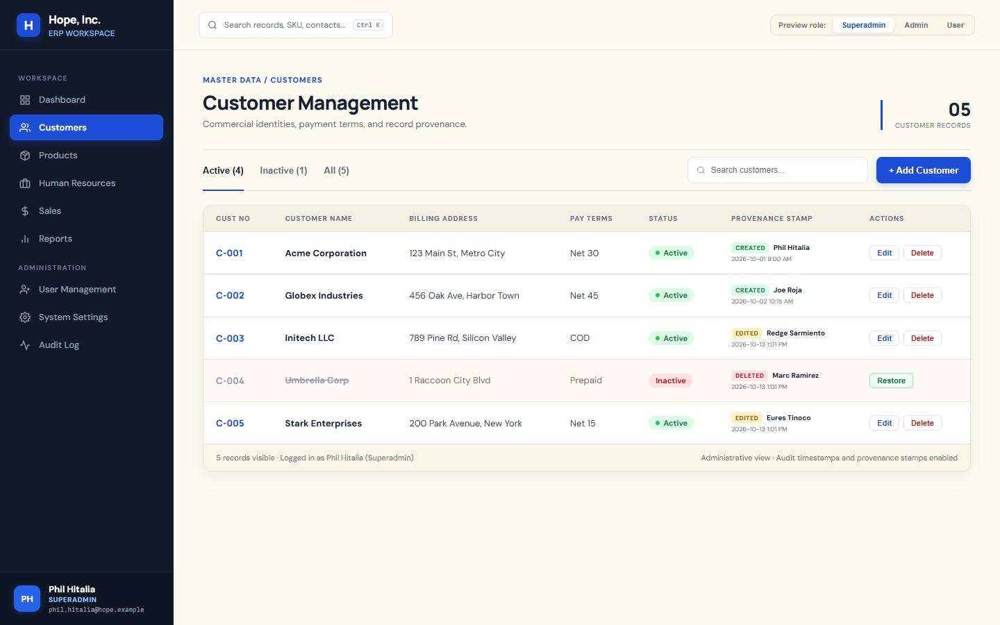

### Layout and components
* **Header & Global Metadata:** Features a `MASTER DATA / CUSTOMERS` breadcrumb above the primary "Customer Management" heading, accompanied by an explanatory subtitle (*"Commercial identities, payment terms, and record provenance."*). A top-right counter badge highlights the dataset size (`05 CUSTOMER RECORDS`).
* **Toolbar Controls:**
  * **Segmented Status Tabs:** Left-aligned tabs (`Active (4)`, `Inactive (1)`, `All (5)`) provide instant toggling between operational customers and soft-deleted records.
  * **Search & Filter:** Centered search input (`Search customers...`) supporting real-time debounce querying across customer names and account numbers.
  * **Primary Action:** Solid blue `+ Add Customer` button pinned to the top right to initiate the onboarding flow.
* **Master Data Table:**
  * **Columns:** `CUST NO`, `CUSTOMER NAME`, `BILLING ADDRESS`, `PAY TERMS`, `STATUS`, `PROVENANCE STAMP`, and `ACTIONS`.
  * **Row States:** Active rows display green status badges (`Active`); soft-deleted rows (e.g., `C-004 Umbrella Corp`) feature a subdued red badge (`Inactive`), strike-through typography, and swap action buttons for an outlined `Restore` button.
  * **Granular Provenance:** Every row features an authorial audit badge (e.g., `CREATED Phil Hitalia`, `CREATED Joe Roja`, `EDITED Redge Sarmiento`, `DELETED Marc Ramirez`, `EDITED Eures Tinoco`).
* **Administrative Footer:** Surfaces real-time viewing parameters (*"5 records visible · Logged in as Phil Hitalia (Superadmin)"*) and confirms active audit status (*"Administrative view · Audit timestamps and provenance stamps enabled"*).

---

## 2. Add Customer Modal

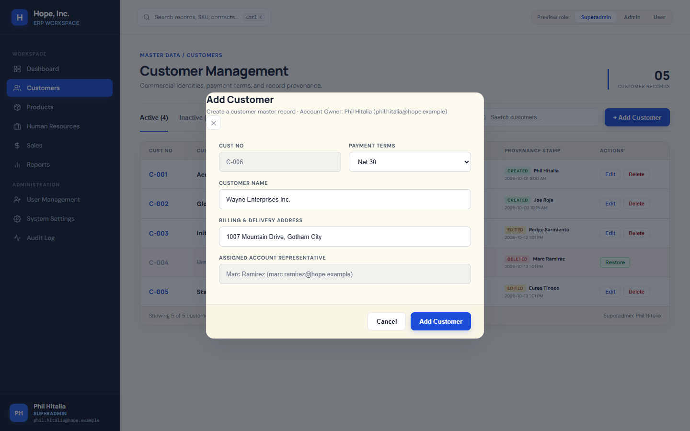

### Layout and components
* **Modal Header:** Declares modal purpose (`Add Customer`) paired with an ownership attribution subline (*"Create a customer master record · Account Owner: Phil Hitalia (phil.hitalia@hope.example)"*) and a top-right close (`X`) icon.
* **Form Structure:**
  * **Top Row (Code & Payment Terms):** Organizes the auto-generated, read-only `CUST NO` (`C-006`) side-by-side with the `PAYMENT TERMS` dropdown selector (`Net 30`) to optimize vertical space.
  * **Customer Name:** Full-width input with guidance value (`Wayne Enterprises Inc.`).
  * **Billing & Delivery Address:** Full-width multiline input capturing physical address specifications (`1007 Mountain Drive, Gotham City`).
  * **Assigned Account Representative:** Pre-filled commercial liaison field (`Marc Ramirez (marc.ramirez@hope.example)`).
* **Modal Actions:** Bottom-right button grouping featuring an outlined `Cancel` button and a solid blue `Add Customer` confirmation button.

---

## 3. Edit Customer Dialog

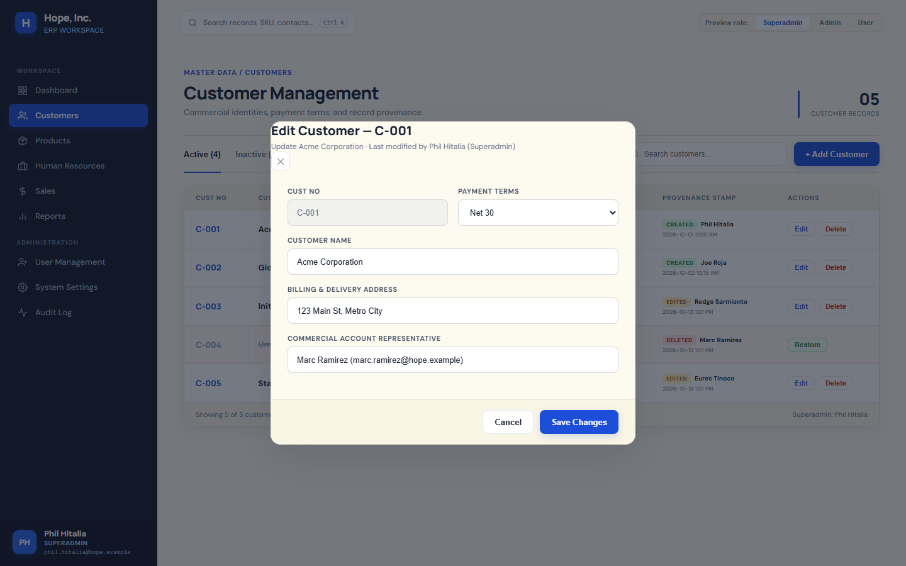

### Layout and components
* **Modal Header:** Displays the target customer identifier (`Edit Customer — C-001`) alongside the modifier context (*"Update Acme Corporation · Last modified by Phil Hitalia (Superadmin)"*).
* **Form Fields:**
  * **Locked Identifier:** The `CUST NO` field remains disabled (`C-001`) to protect database referential integrity.
  * **Editable Commercial Terms:** Allows adjusting the `PAYMENT TERMS` dropdown (`Net 30`) and updating the `CUSTOMER NAME` (`Acme Corporation`).
  * **Billing & Delivery Address:** Fully editable address field (`123 Main St, Metro City`).
  * **Commercial Account Representative:** System field assigning account governance to `Marc Ramirez (marc.ramirez@hope.example)`.
* **Actions:** High-contrast `Save Changes` primary button paired with an outlined `Cancel` button.

---

## 4. Customer Deletion Specifications (Soft-Delete & Blocked States)

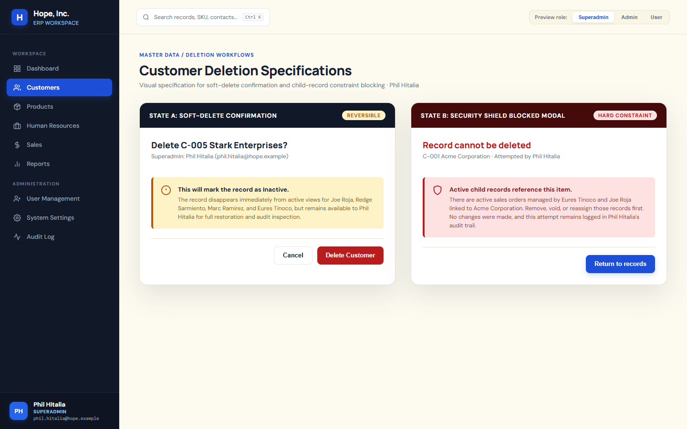

### Layout and components
* **Design Specification Overview:** Side-by-side behavioral guide contrasting the reversible soft-delete state against the hard child-record constraint blocking state.
* **State A: Soft-Delete Confirmation (Reversible):**
  * **Target Identification:** Explicit modal title (`Delete C-005 Stark Enterprises?`) with Superadmin attribution (`Phil Hitalia (phil.hitalia@hope.example)`).
  * **Amber Warning Callout:** Explains the exact operational impact: *"This will mark the record as Inactive. The record disappears immediately from active views for Joe Roja, Redge Sarmiento, Marc Ramirez, and Eures Tinoco, but remains available to Phil Hitalia for full restoration and audit inspection."*
  * **Actions:** Outlined `Cancel` paired with a solid red `Delete Customer` destructive button.
* **State B: Security Shield Blocked Modal (Hard Constraint):**
  * **Severity Indication:** Dark header banner (`Record cannot be deleted`) identifying the target (`C-001 Acme Corporation · Attempted by Phil Hitalia`).
  * **Red Guard Banner:** Prominent shield glyph with clear explanation: *"Active child records reference this item. There are active sales orders managed by Eures Tinoco and Joe Roja linked to Acme Corporation. Remove, void, or reassign those records first. No changes were made, and this attempt remains logged in Phil Hitalia's audit trail."*
  * **Safe Exit:** Single solid blue `Return to records` button ensuring zero accidental data loss.

---

## 5. Customer Management Empty State

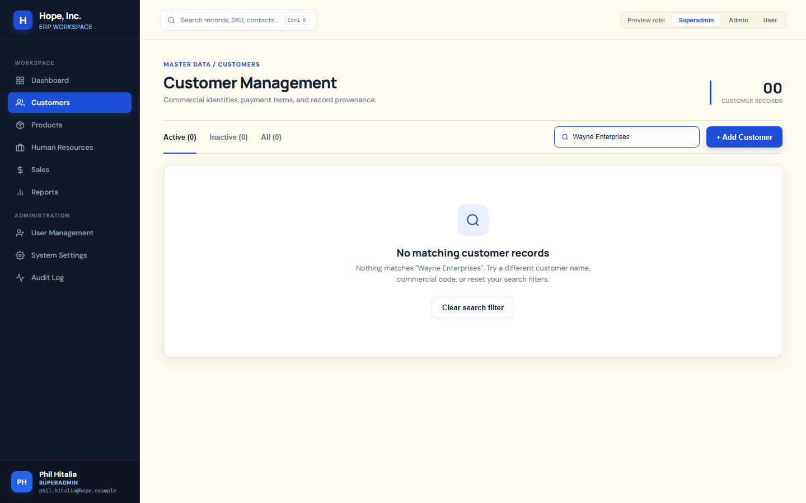

### Layout and components
* **Context Preservation:** Retains full navigation bar, dark sidebar, breadcrumbs, and filter tabs to keep the user oriented during zero-match search queries.
* **Central Feedback Container:** Centered search glyph inside a circular blue container paired with clear guidance copy:
  * **Headline:** *"No matching customer records"*
  * **Helper Text:** *"Nothing matches 'Wayne Enterprises'. Try a different customer name, commercial code, or reset your search filters."*
* **Recovery Action:** Prominent outlined `Clear search filter` button allowing operators to instantly restore the full table with one click.

---

## 6. Product Management Main Screen (Catalog List)

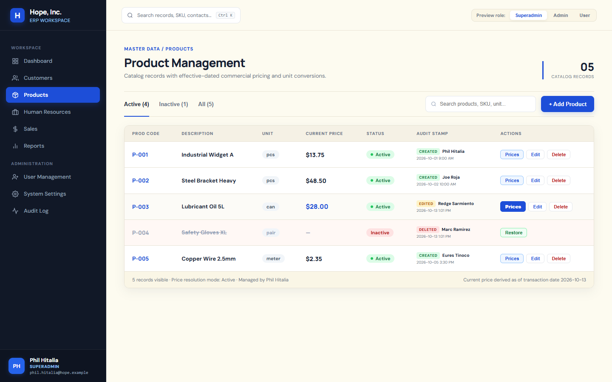

### Layout and components
* **Header & Controls:** Displays `MASTER DATA / PRODUCTS` breadcrumb, "Product Management" heading, and subtitle (*"Catalog records with effective-dated commercial pricing and unit conversions."*), accompanied by a top-right `05 CATALOG RECORDS` badge.
* **Toolbar:** Segmented status tabs (`Active (4)`, `Inactive (1)`, `All (5)`), real-time search bar (`Search products, SKU, unit...`), and a right-aligned `+ Add Product` primary button.
* **Catalog Data Table:**
  * **Columns:** `PROD CODE`, `DESCRIPTION`, `UNIT`, `CURRENT PRICE`, `STATUS`, `AUDIT STAMP`, and `ACTIONS`.
  * **Point-in-Time Price Derivation:** Dynamically computes and displays the active unit price (e.g., `$13.75`, `$48.50`, `$28.00`, `$2.35`) or an em-dash (`—`) for inactive items (`P-004 Safety Gloves XL`).
  * **Action Suite:** Active items provide three quick actions: `Prices` (opens the price history sub-ledger), `Edit` (opens metadata editor), and `Delete` (launches deletion workflow). Soft-deleted rows present a `Restore` button.
* **Administrative Context Footer:** Displays *"5 records visible · Price resolution mode: Active · Managed by Phil Hitalia"* on the left, and *"Current price derived as of transaction date 2026-10-13"* on the right.

---

## 7. Add Product Modal

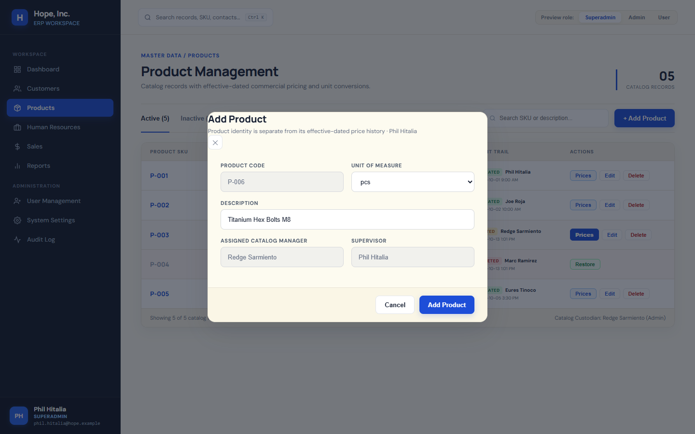

### Layout and components
* **Modal Header:** Declares modal action (`Add Product`) with architectural context note (*"Product identity is separate from its effective-dated price history · Phil Hitalia"*).
* **Form Structure:**
  * **Top Row (Code & UOM):** Read-only auto-generated `PRODUCT CODE` (`P-006`) placed alongside the `UNIT OF MEASURE` dropdown selector (`pcs`).
  * **Description:** Full-width input field with explicit item definition (`Titanium Hex Bolts M8`).
  * **Governance Fields:** Bottom row dividing ownership between `ASSIGNED CATALOG MANAGER` (`Redge Sarmiento`) and `SUPERVISOR` (`Phil Hitalia`).
* **Modal Actions:** Bottom-right pairing of `Cancel` and solid blue `Add Product`.

---

## 8. Edit Product Modal

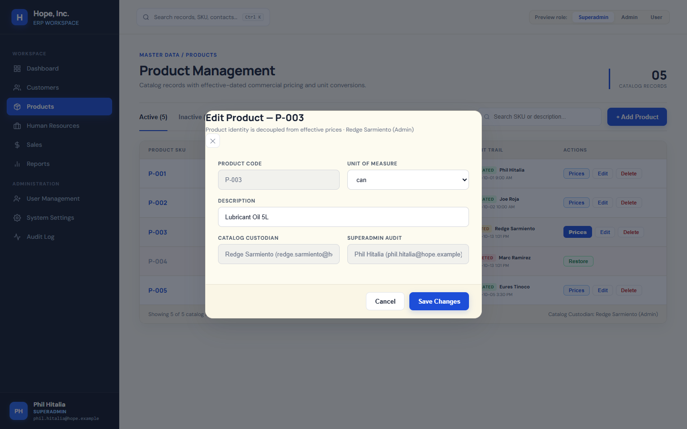

### Layout and components
* **Modal Header:** Identifies the item being modified (`Edit Product — P-003`) with authorial decoupling note (*"Product identity is decoupled from effective prices · Redge Sarmiento (Admin)"*).
* **Form Structure:**
  * **Locked Product Code:** Read-only `PRODUCT CODE` field (`P-003`) safeguarding foreign key linkages.
  * **Editable Attributes:** Dropdown selector for `UNIT OF MEASURE` (`can`) and text input for `DESCRIPTION` (`Lubricant Oil 5L`).
  * **Administrative Accountability:** Bottom row displaying `CATALOG CUSTODIAN` (`Redge Sarmiento (redge.sarmiento@hope.example)`) and `SUPERADMIN AUDIT` (`Phil Hitalia (phil.hitalia@hope.example)`).
* **Actions:** High-contrast `Save Changes` button alongside an outlined `Cancel` button.

---

## 9. Price History Modal (Effective-Dated Sub-Ledger)

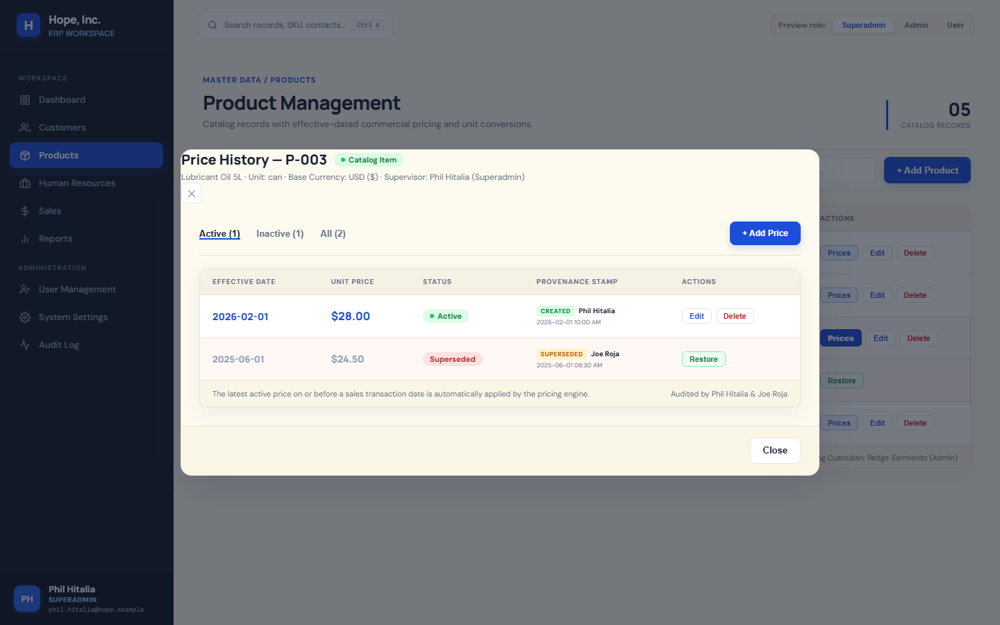

### Layout and components
* **Header & Scope:** Modal title (`Price History — P-003`), green `Catalog Item` pill badge, and scope summary (*"Lubricant Oil 5L · Unit: can · Base Currency: USD ($) · Supervisor: Phil Hitalia (Superadmin)"*).
* **Sub-Ledger Toolbar:**
  * **Filter Tabs:** Segmented sub-tabs (`Active (1)`, `Inactive (1)`, `All (2)`).
  * **Action Button:** Solid blue `+ Add Price` button to schedule a new price tier.
* **Price History Table:**
  * **Columns:** `EFFECTIVE DATE`, `UNIT PRICE`, `STATUS`, `PROVENANCE STAMP`, and `ACTIONS`.
  * **Tier Records:** Shows current active rate (`2026-02-01` | `$28.00` | `Active` | `CREATED Phil Hitalia`) with `Edit` and red `Delete` actions; displays superseded historical rate (`2025-06-01` | `$24.50` | `Superseded` | `SUPERSEDED Joe Roja`) with a `Restore` action.
* **Sub-Ledger Footer:** Surfaces the pricing calculation rule (*"The latest active price on or before a sales transaction date is automatically applied by the pricing engine."*), auditor attribution (*"Audited by Phil Hitalia & Joe Roja"*), and a bottom-right `Close` button.

---

## 10. Add Effective Price Modal

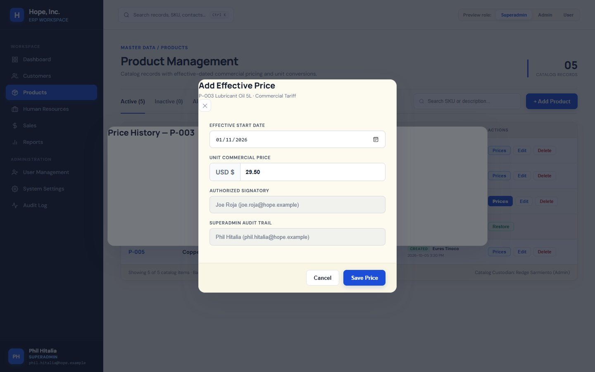

### Layout and components
* **Header:** Identifies modal action (`Add Effective Price`) and product tariff context (*"P-003 Lubricant Oil 5L · Commercial Tariff"*).
* **Form Controls:**
  * **Effective Start Date:** Date input field (`01/11/2026`) with calendar picker icon for temporal scheduling.
  * **Unit Commercial Price:** Currency input field with permanent dollar prefix (`USD $ 29.50`).
  * **Authorized Signatory:** Read-only compliance field displaying the authorizing officer (`Joe Roja (joe.roja@hope.example)`).
  * **Superadmin Audit Trail:** Attribution stamp logging supervisor oversight (`Phil Hitalia (phil.hitalia@hope.example)`).
* **Actions:** Bottom-right grouping of `Cancel` and solid blue `Save Price`.

---

## 11. Product Deletion Specifications (Soft-Delete & Blocked States)

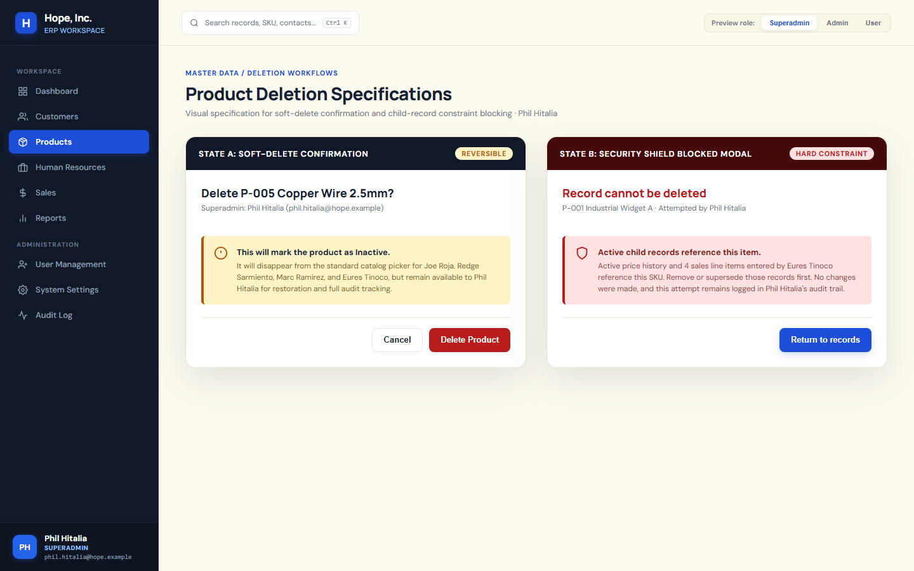

### Layout and components
* **Design Specification Overview:** Dual-panel behavioral specification governing product retirement and database constraint enforcement.
* **State A: Soft-Delete Confirmation (Reversible):**
  * **Target Identification:** Header (`Delete P-005 Copper Wire 2.5mm?`) and supervisor attribution (`Phil Hitalia (phil.hitalia@hope.example)`).
  * **Amber Warning Callout:** Informs the user: *"This will mark the product as Inactive. It will disappear from the standard catalog picker for Joe Roja, Redge Sarmiento, Marc Ramirez, and Eures Tinoco, but remain available to Phil Hitalia for restoration and full audit tracking."*
  * **Actions:** Outlined `Cancel` and solid red `Delete Product` confirmation button.
* **State B: Security Shield Blocked Modal (Hard Constraint):**
  * **Severity Indication:** High-severity modal header (`Record cannot be deleted`) detailing the target (`P-001 Industrial Widget A · Attempted by Phil Hitalia`).
  * **Red Constraint Banner:** Critical warning callout: *"Active child records reference this item. Active price history and 4 sales line items entered by Eures Tinoco reference this SKU. Remove or supersede those records first. No changes were made, and this attempt remains logged in Phil Hitalia's audit trail."*
  * **Safe Exit:** Single solid blue `Return to records` action button.

---

## 12. Product Management Empty State

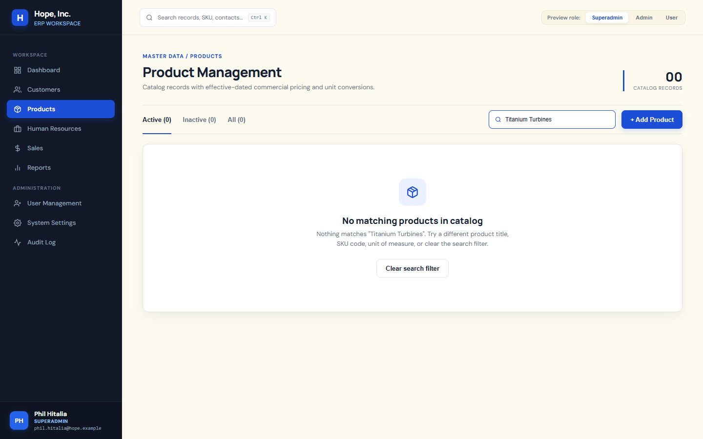

### Layout and components
* **Context Preservation:** Preserves the persistent dark sidebar, top utility navigation bar, `MASTER DATA / PRODUCTS` breadcrumb hierarchy, and segmented filter tabs (`Active (0)`, `Inactive (0)`, `All (0)`) to maintain orientation when search queries yield zero records.
* **Filter Feedback & Counter:** The top-right counter dynamically reflects the zero-match state (`00 CATALOG RECORDS`), providing instant feedback alongside the active query string (`Titanium Turbines`) in the search input.
* **Central Visual Feedback Container:** Centered soft blue container featuring an isometric 3D cube/package glyph paired with structured diagnostic guidance copy:
  * **Headline:** Bold notification title: *"No matching products in catalog"*.
  * **Actionable Guidance:** Explicit recovery instructions: *"Nothing matches 'Titanium Turbines'. Try a different product title, SKU code, unit of measure, or clear the search filter."*
* **Recovery Action:** Prominently positioned outlined `Clear search filter` button enabling catalog managers to instantly purge active search filters and return to the complete product master catalog with a single click.

---
