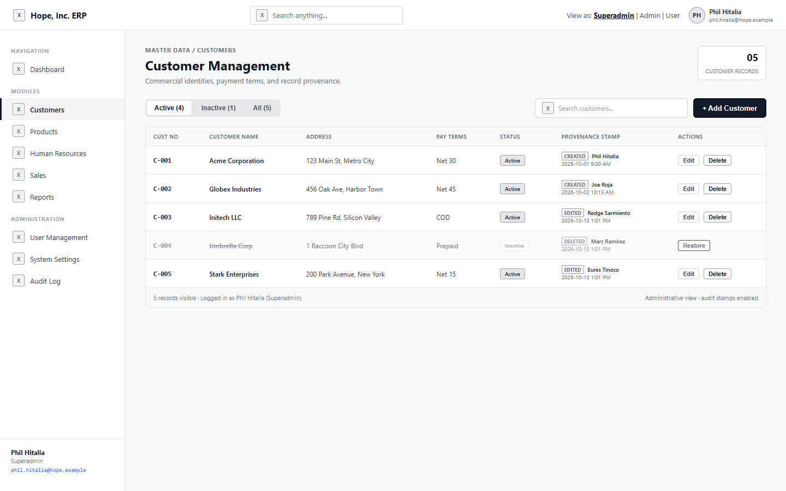
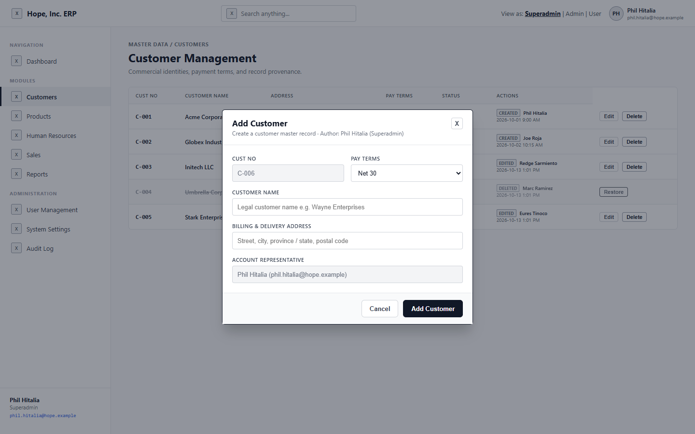
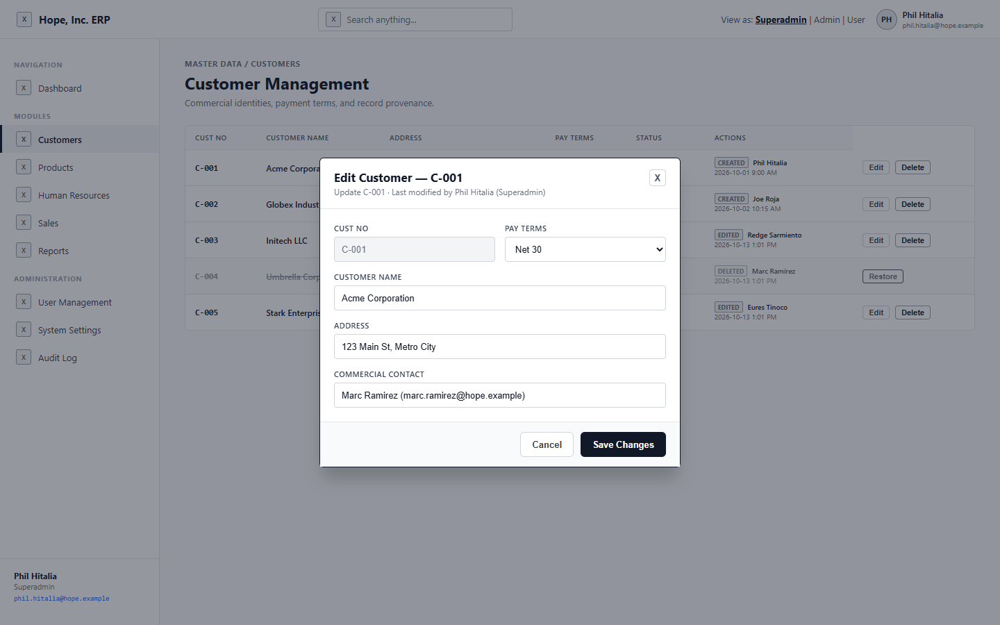
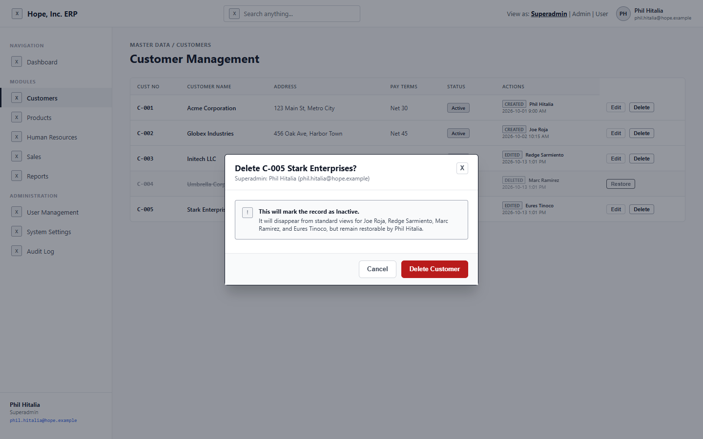
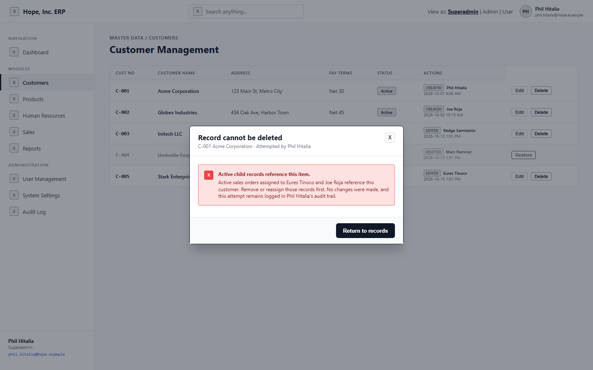
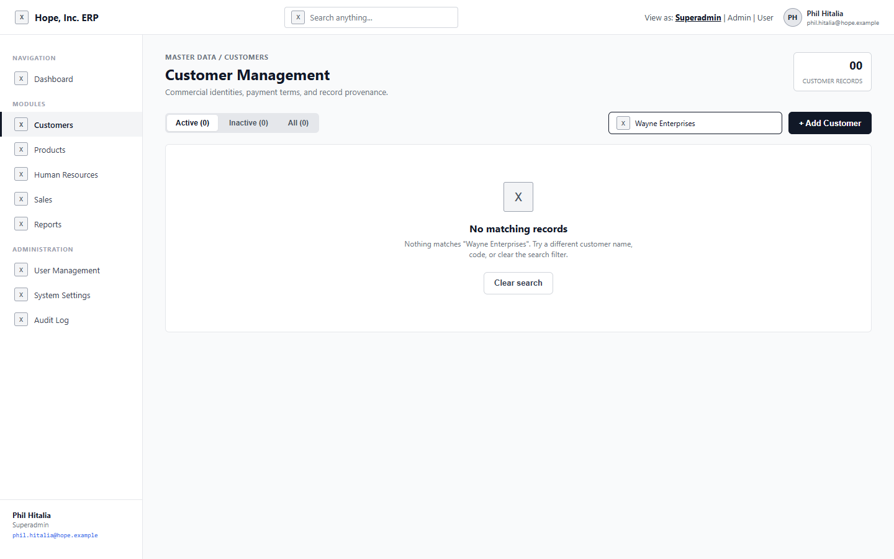

# Hope ERP Customer Management Wireframes

## Task information

| Item | Details |
| ----- | ----- |
| **Task ID** | S2-UIX-01 |
| **Task name** | Wireframes: customer screens |
| **Role** | UI/UX Designer |
| **Assignee** | Phil Emmanuel Hitalia |

## UX Strategy & Architecture

These wireframes define the **Customer Master Data Management** interface for the Hope ERP system. Operating as a critical pillar of the commercial workflow, the design balances dense administrative utility with defensive UX principles:

* **Provenance & Audit Transparency:** Every record in the data grid surfaces an immutable provenance stamp (e.g., `CREATED Phil Hitalia`, `EDITED Redge Sarmiento`, `DELETED Marc Ramirez`) paired with timestamps. This guarantees end-to-end auditability without forcing the operator to open secondary logs.
* **Defensive Deletion & Referential Integrity:** Rather than irreversible hard deletions, the system employs a two-tier safety mechanism:
  1. **Soft Deletion Confirmation:** Explicitly informs the user that the record is flagged as `Inactive` and hidden from operational peers while remaining restorable by Superadmins.
  2. **Integrity Guard (Blocked Delete):** Automatically detects active child dependencies (e.g., pending sales orders assigned to team members) and blocks deletion before database constraint violations occur.
* **Frictionless In-Context Overlays:** Creation, editing, and deletion confirmation occur within centered contextual modals, keeping the list view, compound filter tabs (`Active`, `Inactive`, `All`), and search parameters intact.

---

## 1. Customer Management Main Screen (Master Data List)

### Layout and components
* **Header & Context:** Features a `MASTER DATA / CUSTOMERS` breadcrumb above the primary "Customer Management" heading, accompanied by an explanatory subtitle (*"Commercial identities, payment terms, and record provenance."*). A top-right counter badge displays the active dataset total (e.g., `05 CUSTOMER RECORDS`).
* **Toolbar Controls:**
  * **Status Filter Tabs:** Left-aligned segmented tabs (`Active (4)`, `Inactive (1)`, `All (5)`) allow immediate segment switching.
  * **Search Bar:** A centered input box with an inline search icon (`Search customers...`) for real-time querying across customer names and codes.
  * **Primary Action:** Right-aligned solid `+ Add Customer` button to launch the creation modal.
* **Master Data Table:**
  * **Columns:** `CUST NO`, `CUSTOMER NAME`, `ADDRESS`, `PAY TERMS`, `STATUS`, `PROVENANCE STAMP`, and `ACTIONS`.
  * **Visual Badging:** Uses standardized badge tokens for statuses (`Active` in green, `Inactive` in muted gray) and provenance action types (`CREATED`, `EDITED`, `DELETED`).
  * **Row Actions:** Standard rows display secondary outline buttons (`Edit`, `Delete`). Soft-deleted/inactive rows swap `Delete` for an outlined `Restore` button.
* **Administrative Footer:** Displays an active record summary (*"5 records visible · Logged in as Phil Hitalia (Superadmin)"*) and confirms operational mode (*"Administrative view · audit stamps enabled"*).

---

## 2. Add Customer Modal

### Layout and components
* **Modal Header:** Declares modal purpose (`Add Customer`) paired with an author attribution subline (*"Create a customer master record · Author: Phil Hitalia (Superadmin)"*) and a top-right close (`X`) icon.
* **Form Structure:**
  * **Top Row (Code & Terms):** Places the read-only, auto-incremented `CUST NO` (`C-006`) side-by-side with the `PAY TERMS` dropdown selector (`Net 30`, `Net 15`, `Net 45`, `COD`, `Prepaid`) to minimize modal height.
  * **Customer Name:** Full-width input with illustrative placeholder copy (*"Legal customer name e.g. Wayne Enterprises"*).
  * **Billing & Delivery Address:** Dedicated multi-part address field with standard format hints (*"Street, city, province / state, postal code"*).
  * **Account Representative:** Read-only system field pre-populated with the creating user's identity (*"Phil Hitalia (phil.hitalia@hope.example)"*).
* **Modal Actions:** Bottom-right button cluster pairing an outlined `Cancel` button with a solid dark `Add Customer` primary submission button.

---

## 3. Edit Customer Modal

### Layout and components
* **Modal Header:** Contextualized heading indicating the active target record (`Edit Customer — C-001`) with last-modified metadata (*"Update C-001 · Last modified by Phil Hitalia (Superadmin)"*).
* **Form Structure:**
  * **Locked Identifier:** The `CUST NO` field remains disabled (`C-001`) to preserve relational integrity.
  * **Editable Terms & Details:** Allows direct modification of `PAY TERMS` dropdown, `CUSTOMER NAME`, and `ADDRESS`.
  * **Commercial Contact:** Configurable commercial representative field maintaining the assigned team member's contact profile (*"Marc Ramirez (marc.ramirez@hope.example)"*).
* **Modal Actions:** Bottom-aligned `Cancel` and solid `Save Changes` buttons with clear focus states.

---

## 4. Soft Delete Confirmation Modal

### Layout and components
* **Header:** Explicit warning title identifying the target entity (`Delete C-005 Stark Enterprises?`) and operating actor (*"Superadmin: Phil Hitalia (phil.hitalia@hope.example)"*).
* **Defensive Notice Box:** Uses an attention callout container with an amber/warning indicator (`!`):
  * **Primary Impact Notice:** Boldly declares *"This will mark the record as Inactive."*
  * **Operational Scope Notice:** Spells out exact downstream consequences: *"It will disappear from standard views for Joe Roja, Redge Sarmiento, Marc Ramirez, and Eures Tinoco, but remain restorable by Phil Hitalia."*
* **Modal Actions:** An outlined `Cancel` button contrasted with a high-visibility danger button (`Delete Customer` in destructive red) to prevent accidental clicks.

---

## 5. Record Cannot Be Deleted Modal (Referential Integrity Guard)

### Layout and components
* **Header:** High-severity dialog header (`Record cannot be deleted`) with target reference (*"C-001 Acme Corporation · Attempted by Phil Hitalia"*).
* **Integrity Error Banner:** A bordered danger-themed callout featuring an error glyph (`X`):
  * **Constraint Title:** Bold headline: *"Active child records reference this item."*
  * **Remediation Instructions:** Clear diagnostic copy explaining the exact conflict: *"Active sales orders assigned to Eures Tinoco and Joe Roja reference this customer. Remove or reassign those records first. No changes were made, and this attempt remains logged in Phil Hitalia's audit trail."*
* **Single Safe Action:** Strips away confirmation options, leaving a single neutral dark button: `Return to records`.

---

## 6. Empty State / Zero Search Results Screen

### Layout and components
* **Context Preservation:** Keeps the master data breadcrumb, page title, and search input (`Wayne Enterprises`) intact while dynamically updating the summary counter to `00 CUSTOMER RECORDS` and tab counts to `Active (0)`, `Inactive (0)`, `All (0)`.
* **Zero-State Card:** Replaces table rows with a centered, spacious empty-state placeholder:
  * **Illustration/Glyph:** Minimalist squared icon marker (`X`).
  * **Heading:** Bold `"No matching records"` message.
  * **Supportive Helper Copy:** Explains the cause and suggests remediation: *"Nothing matches 'Wayne Enterprises'. Try a different customer name, code, or clear the search filter."*
  * **Recovery Action:** Centered secondary button `Clear search` that resets the filter and restores full dataset visibility with a single click.

---
