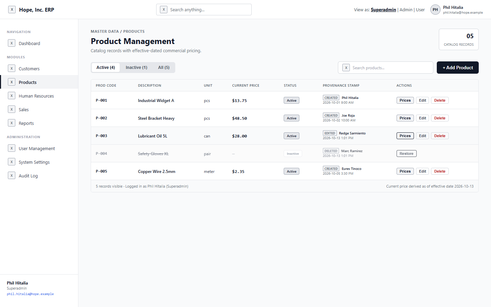
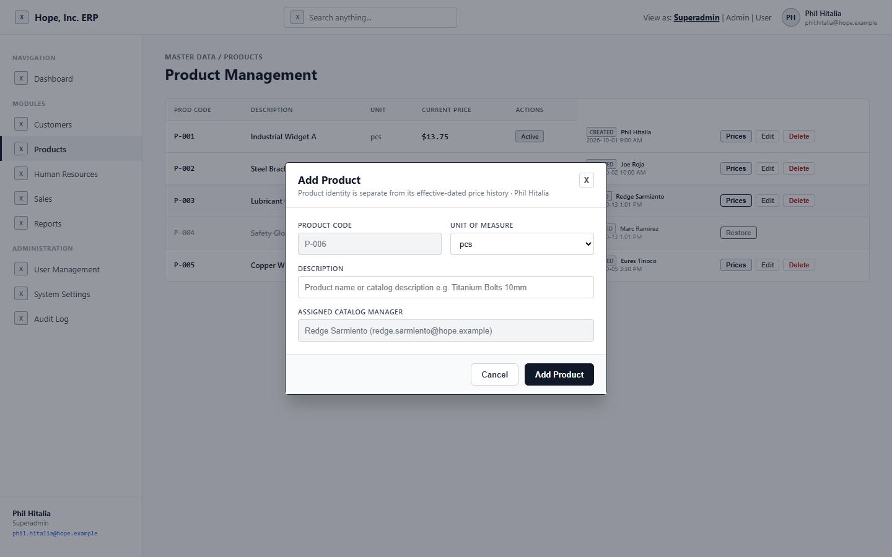
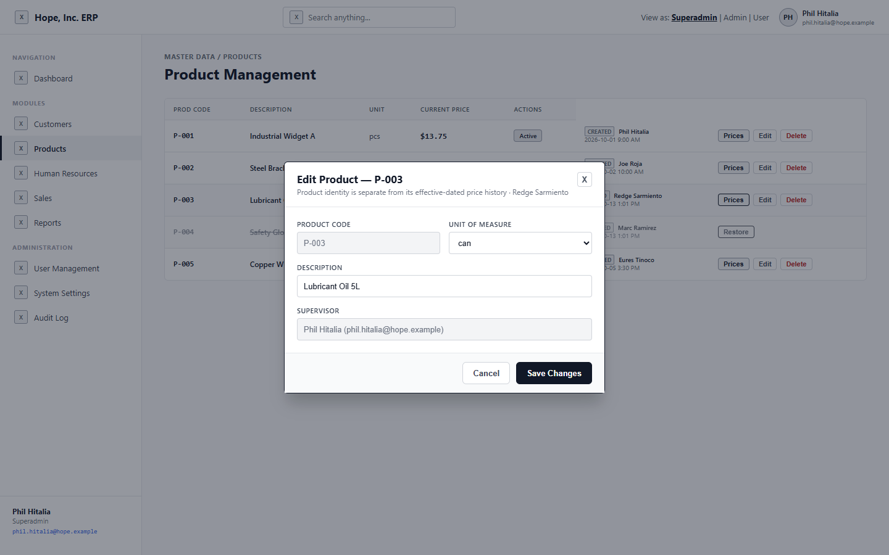
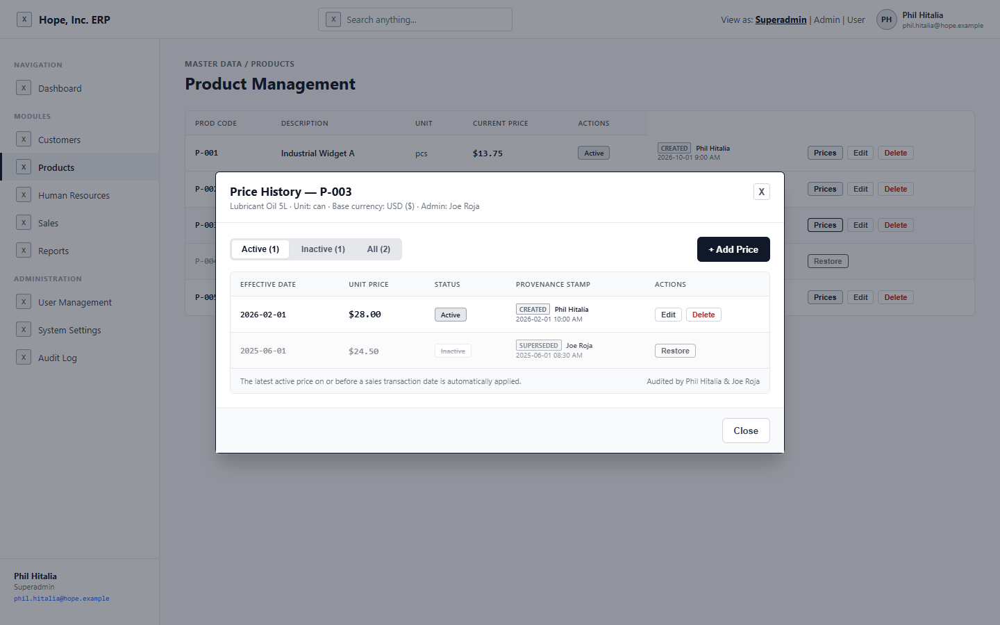
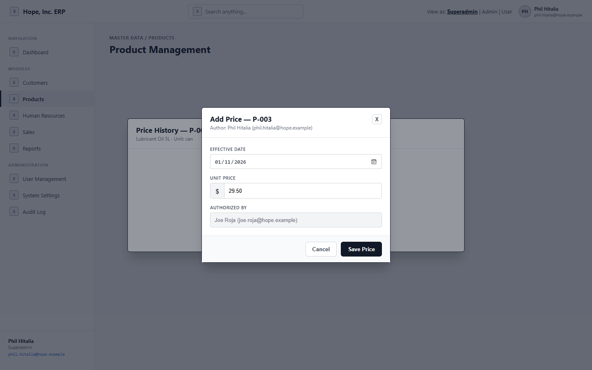
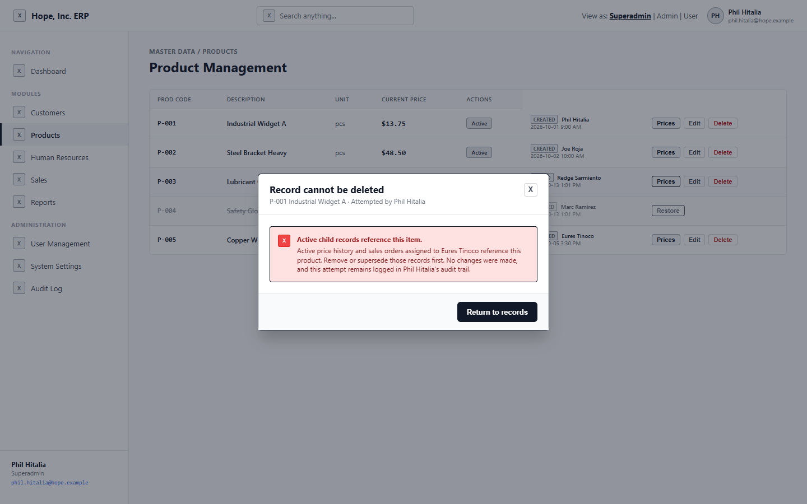

# Hope ERP Product Catalog & Price History Wireframes

## Task information

| Item | Details |
| ----- | ----- |
| **Task ID** | S2-UIX-02 |
| **Task name** | Wireframes: Product Catalog, Effective-Dated Price History & Integrity Modals |
| **Role** | UI/UX Designer |
| **Assignee** | Phil Emmanuel Hitalia |

## UX Strategy & Architecture

These wireframes define the **Product Master Catalog & Effective-Dated Price History** interface for the Hope ERP system. Within enterprise ERP architectures, commercial products require a decoupled data model: the immutable physical item definition is strictly separated from its temporal financial attributes.

* **Decoupled Pricing Model:** Product metadata (Product Code, Unit of Measure, Description, Catalog Manager) remains independent from pricing schedules. A single product maintains a chronologically ordered sub-ledger of effective-dated prices.
* **Point-in-Time Historical Derivation:** In downstream sales transactions, unit pricing is dynamically resolved based on the rule: *"The latest active price on or before a sales transaction date is automatically applied."* This protects historical transaction records from retroactive price volatility.
* **Granular Provenance & Lifecycle Stamps:** Both the product master list and nested price tiers surface audit stamps (`CREATED Phil Hitalia`, `EDITED Redge Sarmiento`, `SUPERSEDED Joe Roja`, `DELETED Marc Ramirez`), giving administrators continuous visibility into who authorized financial adjustments.
* **Referential Integrity Protection:** Products tied to active price schedules or historical sales order line items cannot be deleted. Attempting deletion triggers a defensive integrity guard explaining the exact blocker and preserving the audit trail.

---

## 1. Product Management Main Screen (Catalog List)

### Layout and components
* **Header & Context:** Features a `MASTER DATA / PRODUCTS` breadcrumb positioned above the primary "Product Management" heading, paired with the subtitle (*"Catalog records with effective-dated commercial pricing."*). A top-right counter badge displays total catalog entities (`05 CATALOG RECORDS`).
* **Toolbar Controls:**
  * **Status Filter Tabs:** Segmented tabs (`Active (4)`, `Inactive (1)`, `All (5)`) for instantaneous filtering between active catalog items and soft-deleted records.
  * **Search Bar:** Centered input field with an inline search icon (`Search products...`) supporting live debounce filtering across codes and descriptions.
  * **Primary Action:** Right-aligned solid button `+ Add Product` to initiate the item creation workflow.
* **Catalog Data Table:**
  * **Columns:** `PROD CODE`, `DESCRIPTION`, `UNIT`, `CURRENT PRICE`, `STATUS`, `PROVENANCE STAMP`, and `ACTIONS`.
  * **Current Price Derivation:** Displays the currently effective monetary value (e.g., `$13.75`, `$48.50`, `$28.00`, `$2.35`) or an em-dash (`—`) for inactive/unpriced items.
  * **Multi-Action Controls:** Active items feature three secondary action buttons:
    * `Prices`: Launches the nested Price History modal for that specific product.
    * `Edit`: Opens the item metadata editor.
    * `Delete`: Initiates the soft deletion confirmation flow.
  * **Inactive Row State:** Soft-deleted products display an `Inactive` badge, dimmed typography, and swap action buttons for an outlined `Restore` button.
* **Administrative Footer:** Surfaces record counts (*"5 records visible · Logged in as Phil Hitalia (Superadmin)"*) and confirms effective-date calculation context (*"Current price derived as of effective date 2026-10-13"*).

---

## 2. Add Product Modal

### Layout and components
* **Modal Header:** Declares modal action (`Add Product`) accompanied by an architectural helper note (*"Product identity is separate from its effective-dated price history · Phil Hitalia"*) and a top-right close (`X`) icon.
* **Form Structure:**
  * **Top Row (Code & UOM):** Organizes the auto-generated, read-only `PRODUCT CODE` (`P-006`) side-by-side with the `UNIT OF MEASURE` dropdown selector (`pcs`, `can`, `pair`, `meter`, `box`) to optimize vertical space.
  * **Description:** Full-width input with guidance placeholder (*"Product name or catalog description e.g. Titanium Bolts 10mm"*).
  * **Assigned Catalog Manager:** Read-only system field designating administrative ownership (*"Redge Sarmiento (redge.sarmiento@hope.example)"*).
* **Modal Actions:** Bottom-right button grouping featuring an outlined `Cancel` button and a solid dark `Add Product` primary confirmation button.

---

## 3. Edit Product Modal

### Layout and components
* **Modal Header:** Displays the target product code (`Edit Product — P-003`) alongside author metadata (*"Product identity is separate from its effective-dated price history · Redge Sarmiento"*).
* **Form Structure:**
  * **Locked Identifier:** The `PRODUCT CODE` field remains disabled (`P-003`) to safeguard database foreign key relationships.
  * **Editable Unit & Description:** Allows updating the `UNIT OF MEASURE` dropdown (`can`) and `DESCRIPTION` (`Lubricant Oil 5L`).
  * **Supervisor Field:** Pre-filled oversight field (*"Phil Hitalia (phil.hitalia@hope.example)"*).
* **Modal Actions:** Bottom-aligned `Cancel` button paired with a high-contrast `Save Changes` button.

---

## 4. Price History Modal (Effective-Dated Sub-Ledger)

### Layout and components
* **Modal Header:** Identifies the active product and commercial scope (`Price History — P-003`), with supporting context (*"Lubricant Oil 5L · Unit: can · Base currency: USD ($) · Admin: Joe Roja"*).
* **Sub-Ledger Toolbar:**
  * **Filter Tabs:** Segmented sub-tabs (`Active (1)`, `Inactive (1)`, `All (2)`) to filter historical price tiers.
  * **Action Button:** Dedicated `+ Add Price` button launching the rate assignment overlay.
* **Price History Table:**
  * **Columns:** `EFFECTIVE DATE`, `UNIT PRICE`, `STATUS`, `PROVENANCE STAMP`, and `ACTIONS`.
  * **Historical Records:** Surfaces active effective pricing (`2026-02-01` | `$28.00` | `Active` | `CREATED Phil Hitalia`) alongside superseded or archived price points (`2025-06-01` | `$24.50` | `Inactive` | `SUPERSEDED Joe Roja`).
  * **Row Actions:** Active rates display `Edit` and destructive `Delete` (red text) actions; superseded rates display a `Restore` action.
* **Sub-Ledger Footer:**
  * **Policy Note:** Reasserts temporal computation logic (*"The latest active price on or before a sales transaction date is automatically applied."*).
  * **Auditor Attribution:** Identifies governing administrators (*"Audited by Phil Hitalia & Joe Roja"*).
  * **Close Action:** Bottom-right standalone `Close` button to dismiss the sub-ledger.

---

## 5. Add Price Modal

### Layout and components
* **Modal Header:** Identifies product target (`Add Price — P-003`) and originating author (*"Author: Phil Hitalia (phil.hitalia@hope.example)"*).
* **Form Controls:**
  * **Effective Date:** Date picker input field (`01/11/2026`) with calendar glyph integration, allowing operators to backdate or forward-date price schedules.
  * **Unit Price:** Monospace currency input field with permanent dollar sign prefix (`$ 29.50`).
  * **Authorized By:** Read-only compliance field displaying the authorizer profile (*"Joe Roja (joe.roja@hope.example)"*).
* **Modal Actions:** Bottom-right pairing of `Cancel` and solid `Save Price` buttons.

---

## 6. Record Cannot Be Deleted Modal (Product Integrity Guard)

### Layout and components
* **Header:** High-severity modal title (`Record cannot be deleted`) identifying the affected entity (*"P-001 Industrial Widget A · Attempted by Phil Hitalia"*).
* **Defensive Integrity Banner:** High-visibility danger callout with red border and warning glyph (`X`):
  * **Headline:** Bold alert title: *"Active child records reference this item."*
  * **Diagnostic Explanation:** Detailed operational feedback: *"Active price history and sales orders assigned to Eures Tinoco reference this product. Remove or supersede those records first. No changes were made, and this attempt remains logged in Phil Hitalia's audit trail."*
* **Single Safe Action:** Solitary neutral button `Return to records` ensuring the operator safely exits without data alteration.

---
