# Hope ERP Human Resources, Job History & User Profile (High-Fidelity)

## Task information

| Item | Details |
| ----- | ----- |
| **Task ID** | S3-UIX-03 |
| **Task name** | Hi-fi mockups and handoff notes |
| **Role** | UI/UX Designer |
| **Assignee** | Phil Emmanuel Hitalia |

## UX Strategy & User Flow Context

These high-fidelity mockups transition the Sprint 3 Human Resources, Job History, and User Profile wireframes into a production-ready visual interface. Built on the Hope Inc. ERP design system (`#0f172a` midnight navy sidebar with the `[H] Hope, Inc. / ERP WORKSPACE` brand mark, `#f8fafc` high-contrast content canvas, `#2563eb` royal blue primary actions, and `Manrope` / `DM Sans` typography), the interface balances dense workforce administration with defensive data integrity:

* **Unified HR Workspace & Provenance Transparency:** Departments, Jobs, and Employees share a persistent horizontal module navigation bar (`Departments`, `Jobs`, `Employees`) while surfacing inline audit provenance badges (`CREATED` in indigo, `EDITED` in amber, `DELETED` in crimson) alongside timestamps.
* **Effective-Dated Career & Salary Sub-Ledger:** Employee core identity is decoupled from temporal job assignments. Each employee's **Job History Sub-Ledger** supports switching between a structured **Table View** and an interactive **Timeline View**, enforcing effective-date uniqueness and positive numeric compensation rules.
* **Two-Tier Defensive Deletion & Validation:**
  1. *Inline Temporal Validation:* Prevents invalid employment dates (e.g., `Separation Date` earlier than `Hire Date`) before submission.
  2. *Soft Deletion vs. Integrity Guard:* Reversible soft-deletion confirmations warn about peer visibility, while referential integrity shields cleanly block deletion when active employees or sales orders depend on a record.
* **Self-Service Profile & Engineering Handoff:** Includes a dedicated Profile & Account Settings screen (activated from the bottom-left sidebar user card) and a complete Developer Handoff Specification sheet documenting visual tokens, field validations, API contracts, and RBAC rules.

---

## 1. Department Management Main Screen

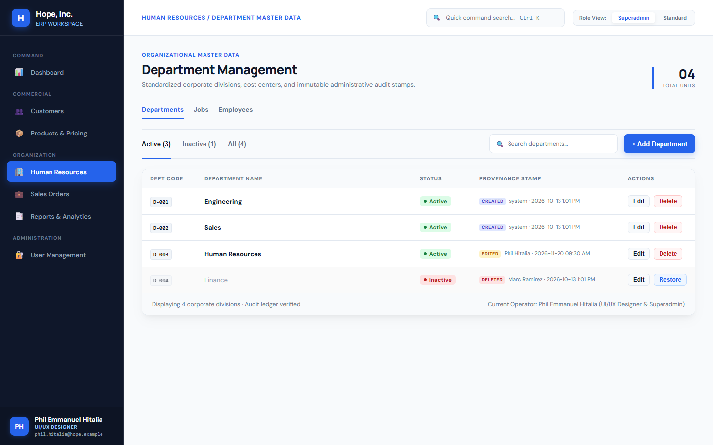

### Layout and components
* **Header & Global Metadata:** Displays the `ORGANIZATIONAL MASTER DATA` kicker above the `"Department Management"` heading and subtitle (*"Standardized corporate divisions, cost centers, and immutable administrative audit stamps."*). A top-right left-bordered counter displays `04 TOTAL UNITS`.
* **Toolbar Controls:**
  * **Module Tabs:** Horizontal tabs (`Departments` active in blue, `Jobs`, `Employees`).
  * **Segmented Status Filters:** `Active (3)`, `Inactive (1)`, `All (4)` with a bottom blue active indicator.
  * **Search & Primary Action:** Search input (`Search departments...`) paired with a solid blue `+ Add Department` button.
* **Master Data Table:**
  * **Columns:** `DEPT CODE`, `DEPARTMENT NAME`, `STATUS`, `PROVENANCE STAMP`, and `ACTIONS`.
  * **Row States:** Active divisions (`D-001 Engineering`, `D-002 Sales`, `D-003 Human Resources`) show emerald green `Active` dot badges; soft-deleted `D-004 Finance` uses a red `Inactive` badge, muted strike-through text, and swaps `Delete` for a soft-blue `Restore` button.
* **Administrative Footer:** Displays *"Displaying 4 corporate divisions · Audit ledger verified"* and *"Current Operator: Phil Emmanuel Hitalia (UI/UX Designer & Superadmin)"*.

---

## 2. Add New Department Modal

### Layout and components
* **Modal Header:** Declares modal purpose (`Add New Department`) with attribution (*"Provision an organizational unit · Author: Phil Emmanuel Hitalia"*) over a blurred dark backdrop.
* **Form Structure:**
  * **Top Row:** Side-by-side disabled `Department Code` (`D-005`) and `Initial Status` (`Active`) fields.
  * **Department Title:** Required text input (`Quality Assurance & Reliability`) with focus ring styling.
  * **Provenance Stamp Preview:** Read-only audit preview (`CREATED Phil Hitalia (Superadmin) · 2026-11-25 10:00 PM`).
* **Modal Actions:** Outlined `Cancel` button and solid blue `Save Department` primary CTA.

---

## 3. Edit Department Modal

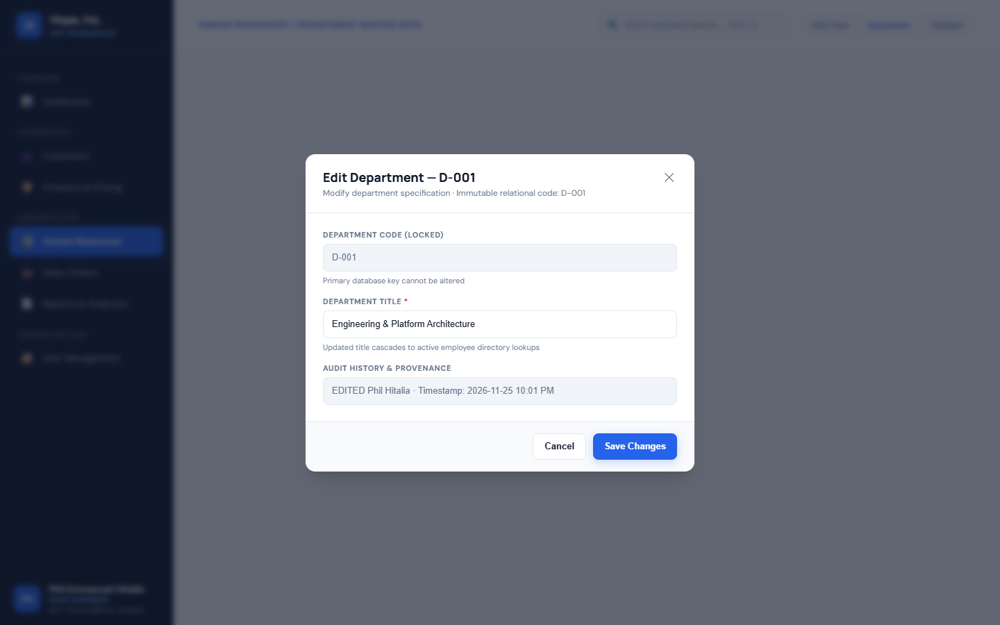

### Layout and components
* **Modal Header:** Identifies the target entity (`Edit Department — D-001`) and relational note (*"Modify department specification · Immutable relational code: D-001"*).
* **Form Fields:**
  * **Locked Identifier:** Disabled `Department Code (Locked)` (`D-001`) protecting foreign key linkages.
  * **Department Title:** Editable required field (`Engineering & Platform Architecture`) with cascading lookup helper text.
  * **Audit History & Provenance:** Read-only field (`EDITED Phil Hitalia · Timestamp: 2026-11-25 10:01 PM`).
* **Actions:** `Cancel` and solid blue `Save Changes`.

---

## 4. Job Catalog Management Screen

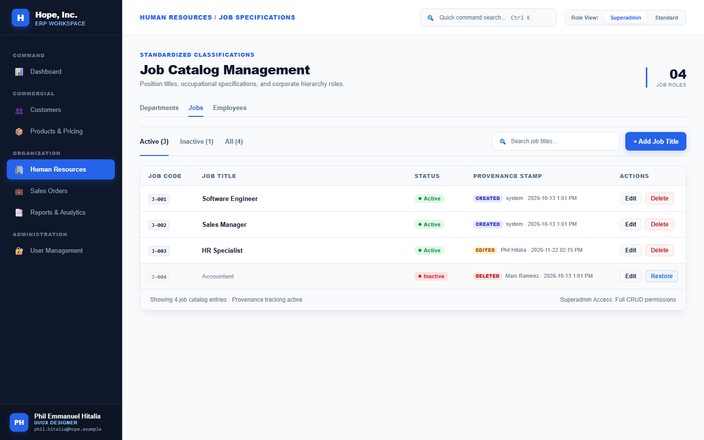

### Layout and components
* **Header & Controls:** Displays `STANDARDIZED CLASSIFICATIONS` kicker, `"Job Catalog Management"` heading, and `04 JOB ROLES` counter badge. Switches module tab highlight to `Jobs`.
* **Toolbar:** `Active (3)`, `Inactive (1)`, `All (4)` status tabs, `Search job titles...` input, and `+ Add Job Title` CTA.
* **Catalog Data Table:**
  * **Columns:** `JOB CODE`, `JOB TITLE`, `STATUS`, `PROVENANCE STAMP`, and `ACTIONS`.
  * **Row Content:** Active roles (`J-001 Software Engineer`, `J-002 Sales Manager`, `J-003 HR Specialist`) and soft-deleted `J-004 Accountant` with `Restore` action.
* **Footer:** Confirms *"Superadmin Access: Full CRUD permissions"*.

---

## 5. Add New Job Specification Modal

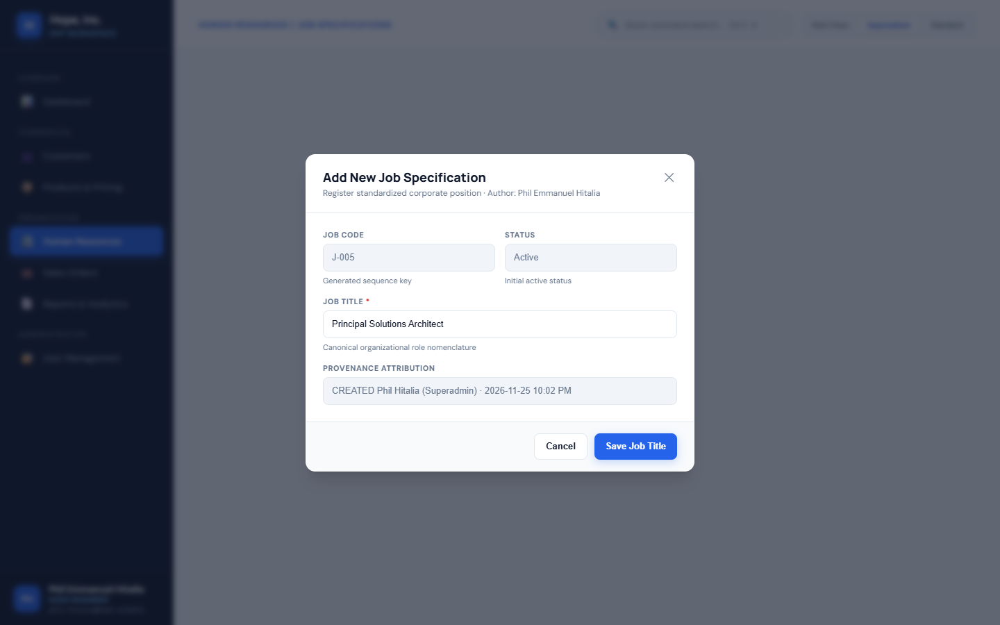

### Layout and components
* **Modal Header:** Title (`Add New Job Specification`) and author attribution (*"Register standardized corporate position · Author: Phil Emmanuel Hitalia"*).
* **Form Structure:**
  * **Code & Status Row:** Auto-generated `Job Code` (`J-005`) and `Status` (`Active`).
  * **Job Title:** Required input (`Principal Solutions Architect`).
  * **Provenance Attribution:** Read-only preview (`CREATED Phil Hitalia (Superadmin) · 2026-11-25 10:02 PM`).
* **Actions:** `Cancel` and solid blue `Save Job Title`.

---

## 6. Employee Directory Main Screen

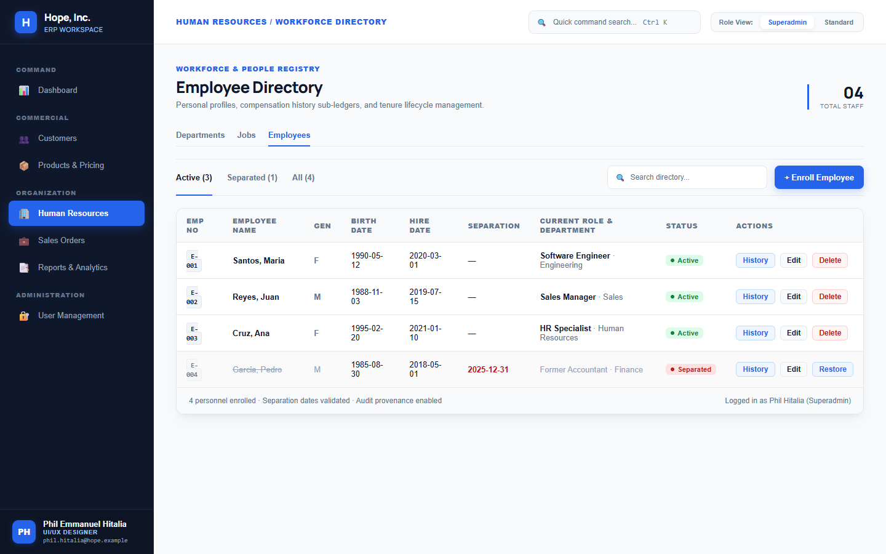

### Layout and components
* **Header & Context:** Displays `WORKFORCE & PEOPLE REGISTRY` kicker, `"Employee Directory"` heading, and `04 TOTAL STAFF` counter badge.
* **Toolbar:** Filter tabs (`Active (3)`, `Separated (1)`, `All (4)`), `Search directory...` input, and `+ Enroll Employee` CTA.
* **Workforce Data Table:**
  * **Columns:** `EMP NO`, `EMPLOYEE NAME`, `GEN`, `BIRTH DATE`, `HIRE DATE`, `SEPARATION`, `CURRENT ROLE & DEPARTMENT`, `STATUS`, and `ACTIONS`.
  * **Action Suite:** Active employees (`E-001 Santos, Maria`, `E-002 Reyes, Juan`, `E-003 Cruz, Ana`) provide `History` (soft blue), `Edit`, and `Delete` (soft red). Separated employee `E-004 Garcia, Pedro` highlights `2025-12-31` in crimson and swaps `Delete` for `Restore`.

---

## 7. Enroll New Employee Modal

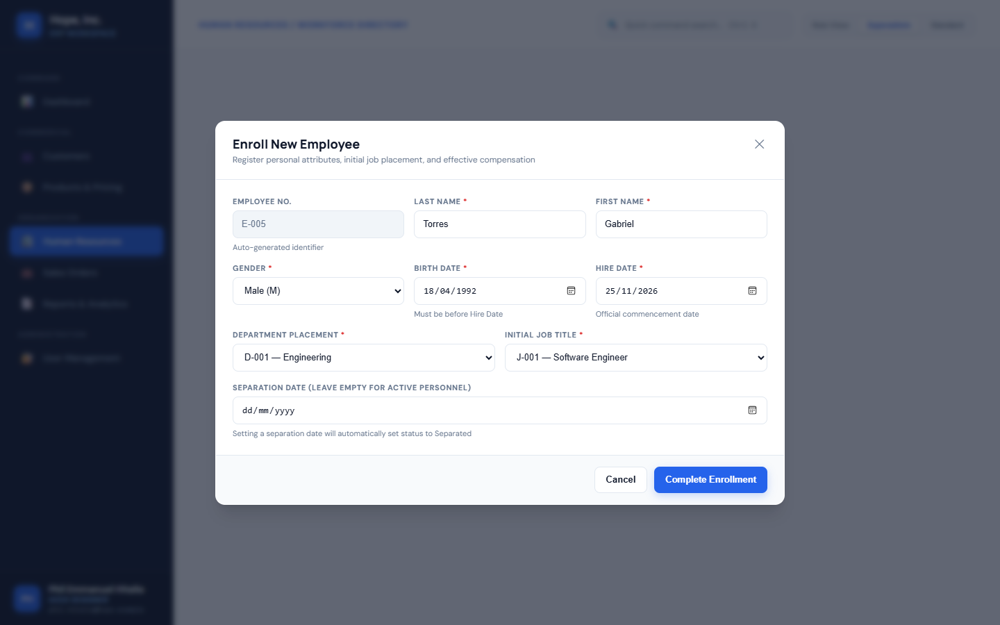

### Layout and components
* **Modal Header:** `Enroll New Employee` (*"Register personal attributes, initial job placement, and effective compensation"*).
* **Multi-Column Form Grid:**
  * **Row 1 (3-Col):** Auto-generated `Employee No.` (`E-005`), `Last Name` (`Torres`), `First Name` (`Gabriel`).
  * **Row 2 (3-Col):** `Gender` (`Male (M)`), `Birth Date` (`1992-04-18` with hint *"Must be before Hire Date"*), `Hire Date` (`2026-11-25`).
  * **Row 3 (2-Col):** `Department Placement` (`D-001 — Engineering`) and `Initial Job Title` (`J-001 — Software Engineer`).
  * **Row 4:** Optional `Separation Date` picker noting automatic `Separated` status transition.
* **Actions:** `Cancel` and `Complete Enrollment`.

---

## 8. Edit Employee Modal (With Separation Date Validation)

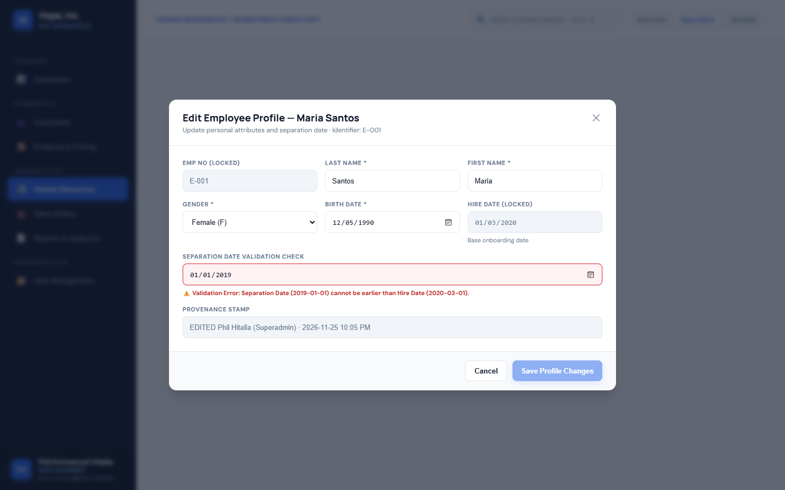

### Layout and components
* **Modal Header:** `Edit Employee Profile — Maria Santos` (*"Update personal attributes and separation date · Identifier: E-001"*).
* **Inline Validation State:**
  * Locks `Emp No` (`E-001`) and `Hire Date` (`2020-03-01`).
  * Highlights an invalid `Separation Date` (`2019-01-01`) with a red border and tinted background, surfacing: *"⚠️ Validation Error: Separation Date (2019-01-01) cannot be earlier than Hire Date (2020-03-01)."*
  * Disables `Save Profile Changes` (`opacity: 0.5`) until the date conflict is resolved.

---

## 9. Job History Sub-Ledger Modal (Table View)

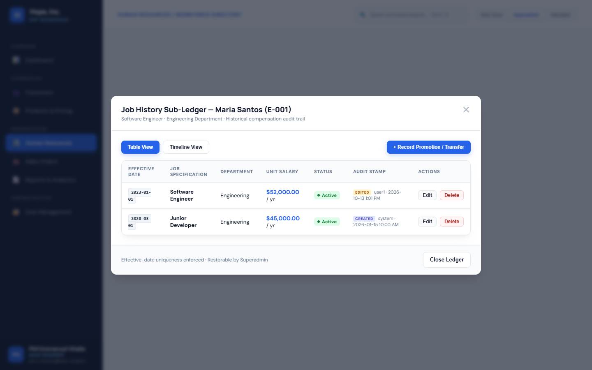

### Layout and components
* **Modal Header:** `Job History Sub-Ledger — Maria Santos (E-001)` (*"Software Engineer · Engineering Department · Historical compensation audit trail"*).
* **Toolbar:** `Table View` (active blue) / `Timeline View` switcher paired with `+ Record Promotion / Transfer`.
* **Sub-Ledger Table:** Displays `EFFECTIVE DATE`, `JOB SPECIFICATION`, `DEPARTMENT`, `UNIT SALARY` (bold blue currency `$52,000.00 / yr`, `$45,000.00 / yr`), `STATUS`, `AUDIT STAMP`, and `ACTIONS` (`Edit`, `Delete`).
* **Footer:** Confirms *"Effective-date uniqueness enforced · Restorable by Superadmin"* alongside `Close Ledger`.

---

## 10. Career Progression Timeline Modal (Timeline View)

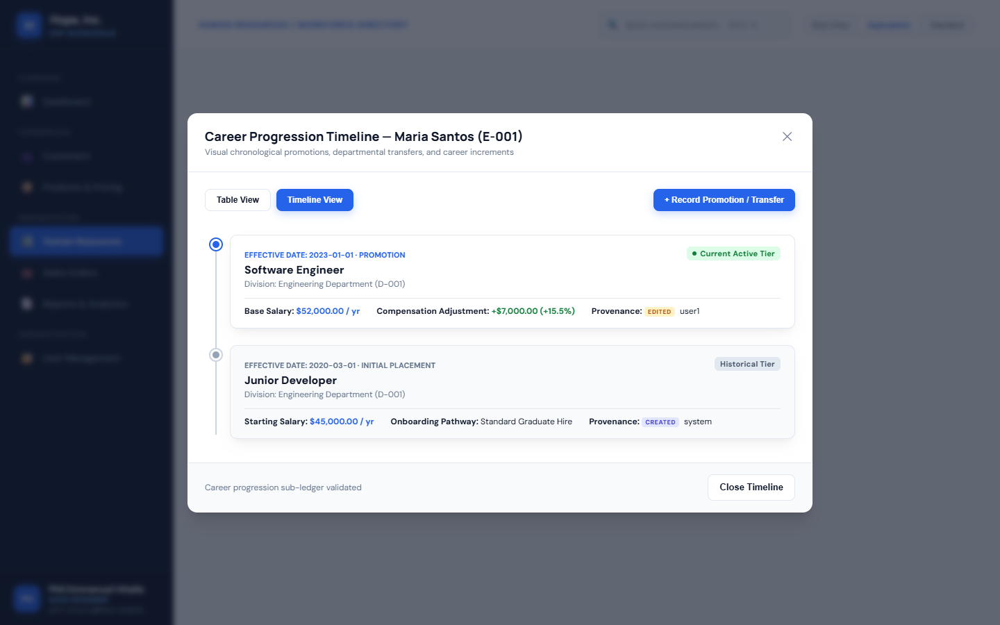

### Layout and components
* **Modal Header:** `Career Progression Timeline — Maria Santos (E-001)` (*"Visual chronological promotions, departmental transfers, and career increments"*).
* **Toolbar:** Highlights `Timeline View` as active.
* **Visual Timeline Nodes:**
  * **Current Tier (`2023-01-01 · Promotion`):** Blue dot marker and elevated card displaying `Software Engineer`, `Engineering Department (D-001)`, `Current Active Tier` badge, `Base Salary: $52,000.00 / yr`, `Compensation Adjustment: +$7,000.00 (+15.5%)`, and `EDITED user1`.
  * **Historical Tier (`2020-03-01 · Initial Placement`):** Neutral gray dot marker and muted card for `Junior Developer` (`$45,000.00 / yr`, `Standard Graduate Hire`, `CREATED system`).

---

## 11. Record Promotion / Department Transfer Nested Modal

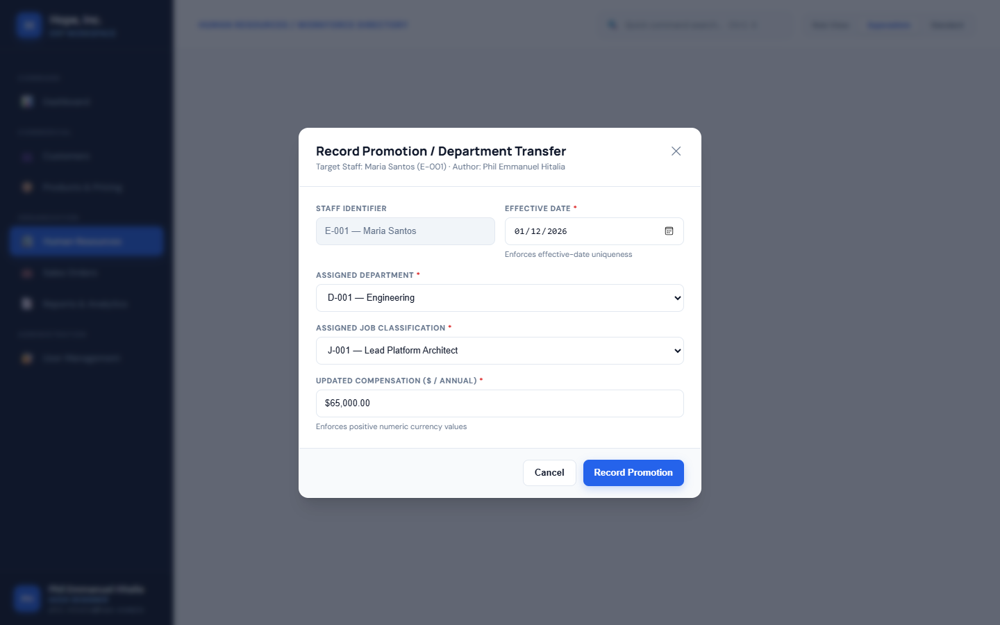

### Layout and components
* **Modal Header:** `Record Promotion / Department Transfer` (*"Target Staff: Maria Santos (E-001) · Author: Phil Emmanuel Hitalia"*).
* **Form Controls:**
  * **Top Row:** Locked `Staff Identifier` (`E-001 — Maria Santos`) and `Effective Date` (`2026-12-01`) with uniqueness enforcement hint.
  * **Placement Selectors:** `Assigned Department` (`D-001 — Engineering`) and `Assigned Job Classification` (`J-001 — Lead Platform Architect`).
  * **Compensation:** `Updated Compensation ($ / Annual)` (`$65,000.00`) enforcing positive numeric values.
* **Actions:** `Cancel` and `Record Promotion`.

---

## 12. HR Defensive Deletion Flows (Soft Delete & Integrity Guard)

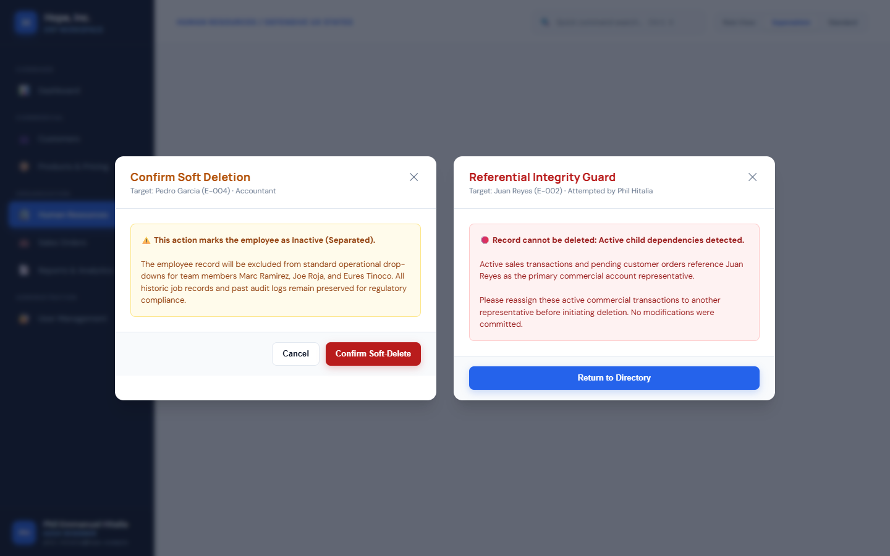

### Layout and components
* **Dual-Modal Behavioral Specification:**
  * **Left — Confirm Soft Deletion (`Pedro Garcia (E-004)`):** Amber warning banner (`⚠️`) explaining that marking the employee `Inactive (Separated)` hides them from standard operational dropdowns while preserving historic job records and audit logs for compliance. Actions: `Cancel` and solid red `Confirm Soft-Delete`.
  * **Right — Referential Integrity Guard (`Juan Reyes (E-002)`):** Red error banner (`🛑`) blocking deletion because active sales transactions and pending customer orders reference Juan Reyes as the primary commercial account representative. Single safe exit button: `Return to Directory`.

---

## 13. User Profile & Account Settings Screen

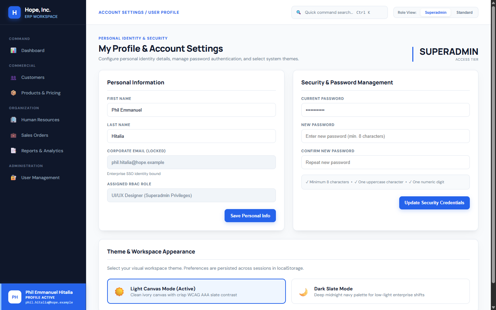

### Layout and components
* **Active Sidebar Profile Selection:** Highlights the bottom-left sidebar user card (`PH · Phil Emmanuel Hitalia · PROFILE ACTIVE`) in royal blue while keeping module links unselected, matching the live application's bottom-left profile navigation.
* **Header & Tier Badge:** `PERSONAL IDENTITY & SECURITY` kicker, `"My Profile & Account Settings"` heading, and right-aligned `SUPERADMIN ACCESS TIER` indicator.
* **Two-Column Settings Grid:**
  * **Personal Information Card:** Editable `First Name` (`Phil Emmanuel`) and `Last Name` (`Hitalia`), locked `Corporate Email` (`phil.hitalia@hope.example`), read-only `Assigned RBAC Role`, and `Save Personal Info` CTA.
  * **Security & Password Management Card:** `Current Password`, `New Password`, `Confirm New Password`, password policy checklist, and `Update Security Credentials` CTA.
* **Theme & Workspace Appearance Card:** Interactive theme selector contrasting `☀️ Light Canvas Mode (Active)` against `🌙 Dark Slate Mode`.

---

## 14. HR Empty State / Zero Search Results

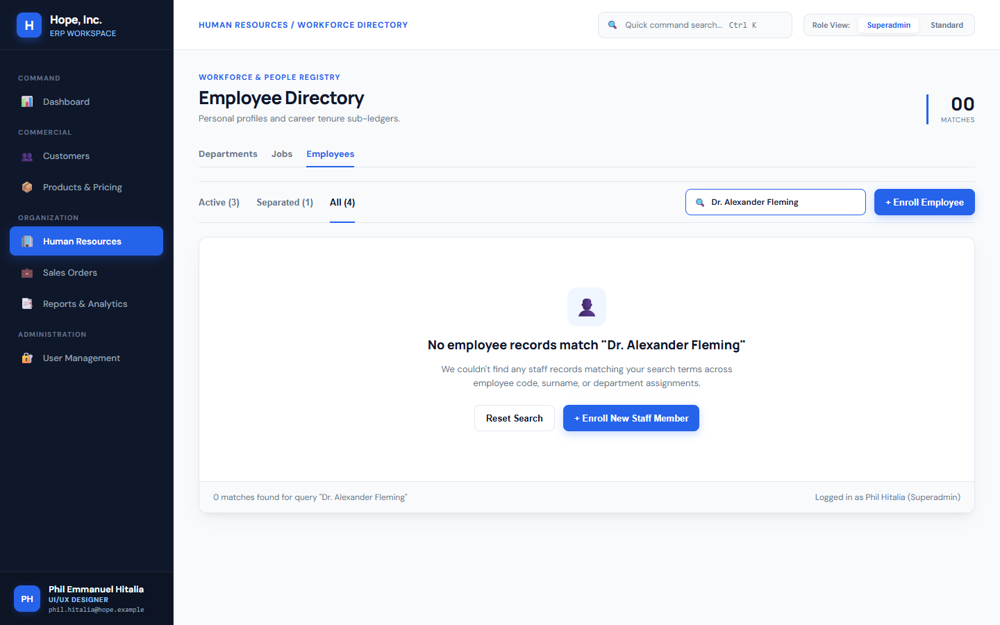

### Layout and components
* **Context Preservation:** Keeps the sidebar, top header, `Employees` tab, `All (4)` filter, and active search query (`Dr. Alexander Fleming`) intact while updating the counter to `00 MATCHES`.
* **Zero-State Card:** Soft blue circular user glyph (`👤`), bold headline (*"No employee records match 'Dr. Alexander Fleming'"*), diagnostic copy, and recovery buttons (`Reset Search` and `+ Enroll New Staff Member`).

---

