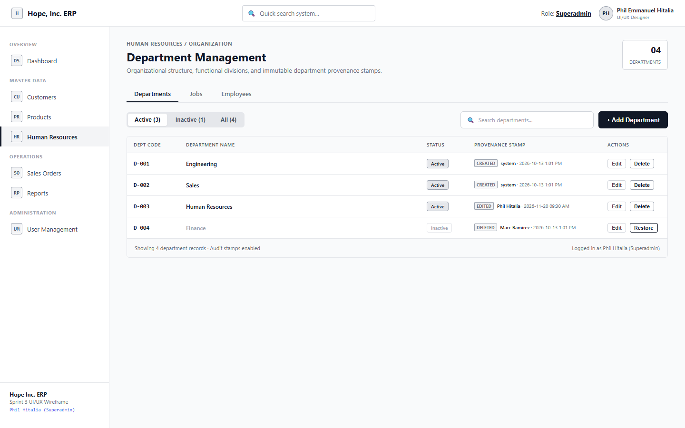
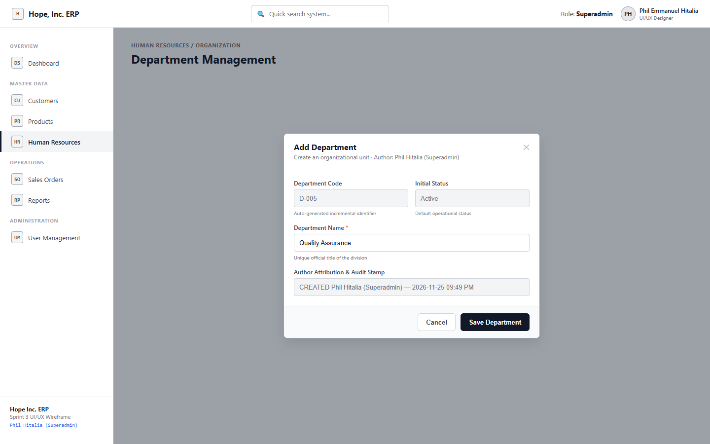
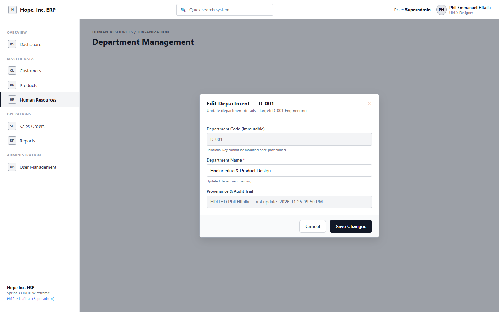
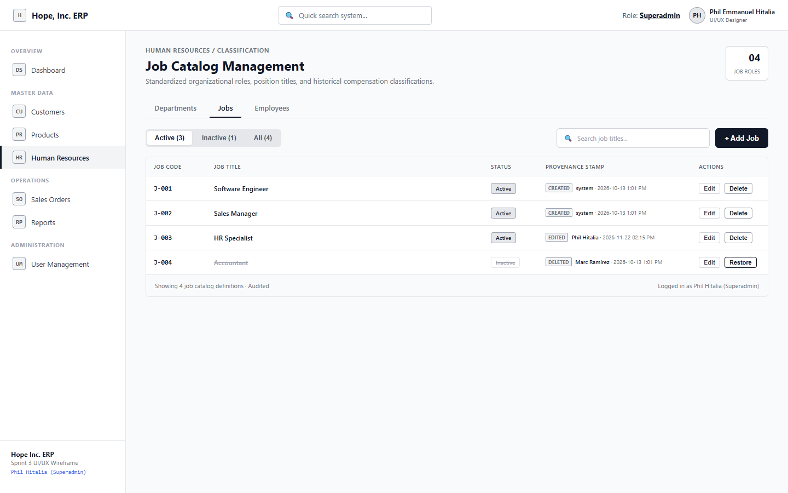
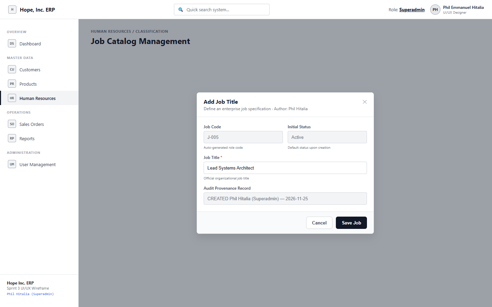
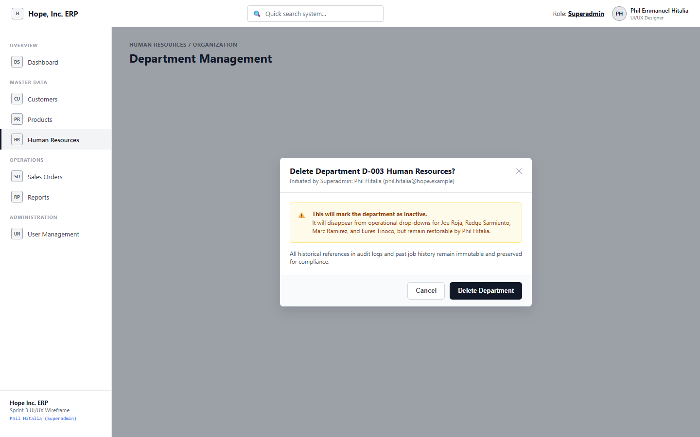
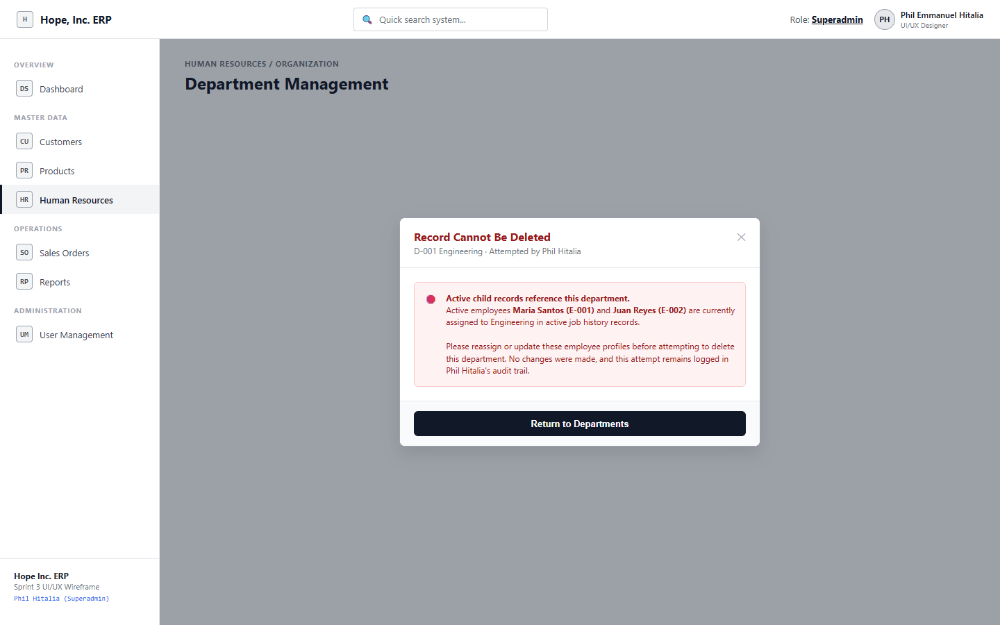
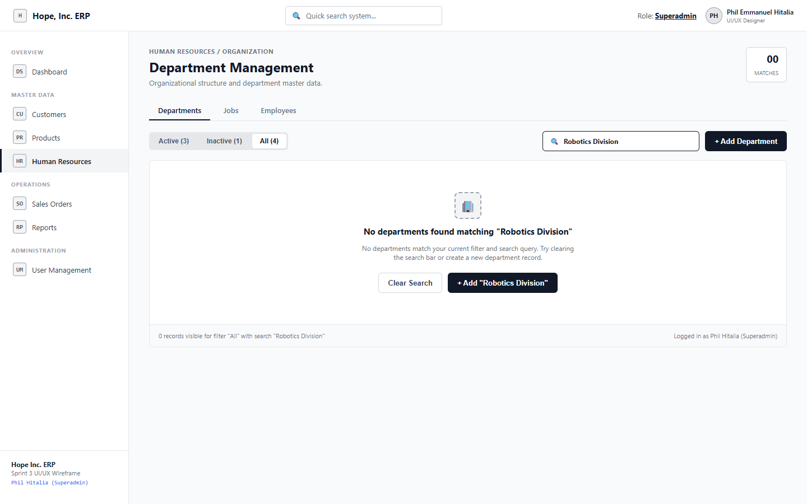

# Hope ERP Department & Job Catalog Wireframes

## Task information

| Item | Details |
| ----- | ----- |
| **Task ID** | S3-UIX-01 |
| **Task name** | Wireframes: department and job screens |
| **Role** | UI/UX Designer |
| **Assignee** | Phil Emmanuel Hitalia |

## UX Strategy & Architecture

These wireframes define the **Department Management & Job Catalog** interfaces within the Human Resources module of the Hope ERP system. Serving as the foundational structural taxonomy for workforce organization, the layout balances clean tabular scanning with strict defensive data integrity controls:

* **Unified Module Navigation:** Both Departments and Jobs live within the `Human Resources` workspace under a persistent horizontal module tab bar (`Departments`, `Jobs`, `Employees`), enabling seamless switching between organizational units and standardized role classifications without losing sidebar orientation.
* **Immutable Provenance & Audit Transparency:** Every department and job record surfaces an inline audit provenance stamp (`CREATED system`, `EDITED Phil Hitalia`, `DELETED Marc Ramirez`) paired with timestamps, giving administrators instant visibility into record history without opening secondary logs.
* **Two-Tier Defensive Deletion:**
  1. **Soft Deletion Confirmation:** Explicitly notifies the operator that deleting an unreferenced department or job marks it as `Inactive` and hides it from operational dropdowns for standard users while remaining restorable by Superadmins.
  2. **Referential Integrity Guard (Blocked Delete):** Automatically blocks deletion if active employee records or job history entries reference the target department or job, surfacing exact conflicting employees and preserving the audit log.
* **Consistent Contextual Modals:** Creation, editing, and deletion checks occur in centered modal overlays, keeping the underlying filter tabs (`Active`, `Inactive`, `All`) and search queries intact.

---

## 1. Department Management Main Screen (Master Data List)

### Layout and components
* **Header & Context:** Displays the `HUMAN RESOURCES / ORGANIZATION` breadcrumb above the primary `"Department Management"` heading and explanatory subtitle (*"Organizational structure, functional divisions, and immutable department provenance stamps."*). A top-right counter card displays the total dataset count (`04 DEPARTMENTS`).
* **Module Sub-Navigation:** Horizontal tabs (`Departments` active, `Jobs`, `Employees`) beneath the page header.
* **Toolbar Controls:**
  * **Status Filter Tabs:** Left-aligned segmented control (`Active (3)`, `Inactive (1)`, `All (4)`) for instant filtering.
  * **Search Bar:** Input box with search glyph (`Search departments...`) for live filtering across department codes and names.
  * **Primary Action:** Right-aligned solid dark `+ Add Department` button to launch the creation modal.
* **Department Data Table:**
  * **Columns:** `DEPT CODE`, `DEPARTMENT NAME`, `STATUS`, `PROVENANCE STAMP`, and `ACTIONS`.
  * **Visual Badging:** Uses standardized wireframe badge tokens (`Active`, `Inactive` with strikethrough text for deleted rows like `D-004 Finance`) and provenance tags (`CREATED`, `EDITED`, `DELETED`).
  * **Row Actions:** Active rows provide `Edit` and `Delete` buttons; inactive rows replace `Delete` with a `Restore` action.
* **Administrative Footer:** Confirms visible count (*"Showing 4 department records · Audit stamps enabled"*) and active session identity (*"Logged in as Phil Hitalia (Superadmin)"*).

---

## 2. Add Department Modal

### Layout and components
* **Modal Header:** Declares modal purpose (`Add Department`) with author attribution (*"Create an organizational unit · Author: Phil Hitalia (Superadmin)"*) and a top-right close (`✕`) button.
* **Form Structure:**
  * **Top Row (Code & Status):** Displays auto-generated read-only `Department Code` (`D-005`) alongside read-only `Initial Status` (`Active`).
  * **Department Name:** Full-width required text field (`Quality Assurance`, placeholder *"e.g. Quality Assurance or Logistics"*) with uniqueness helper text.
  * **Author Attribution & Audit Stamp:** Read-only preview of the generated audit stamp (*"CREATED Phil Hitalia (Superadmin) — 2026-11-25 09:49 PM"*).
* **Modal Actions:** Bottom-right `Cancel` secondary button and solid dark `Save Department` primary button.

---

## 3. Edit Department Modal

### Layout and components
* **Modal Header:** Contextual title identifying the active target (`Edit Department — D-001`) and subtext (*"Update department details · Target: D-001 Engineering"*).
* **Form Structure:**
  * **Locked Identifier:** Disabled `Department Code (Immutable)` field (`D-001`) with helper copy noting that primary relational keys cannot be modified once provisioned.
  * **Department Name:** Editable required input (`Engineering & Product Design`).
  * **Provenance & Audit Trail:** Read-only metadata field displaying the latest modifier and timestamp (*"EDITED Phil Hitalia · Last update: 2026-11-25 09:50 PM"*).
* **Modal Actions:** Bottom-aligned `Cancel` and `Save Changes` buttons.

---

## 4. Job Catalog Management Screen

### Layout and components
* **Header & Context:** Features the `HUMAN RESOURCES / CLASSIFICATION` breadcrumb above `"Job Catalog Management"` (*"Standardized organizational roles, position titles, and historical compensation classifications."*), paired with a `04 JOB ROLES` counter card.
* **Module Sub-Navigation:** Switches active underline indicator to the `Jobs` tab.
* **Toolbar Controls:** Segmented status tabs (`Active (3)`, `Inactive (1)`, `All (4)`), `Search job titles...` input, and `+ Add Job` primary CTA.
* **Job Catalog Data Table:**
  * **Columns:** `JOB CODE`, `JOB TITLE`, `STATUS`, `PROVENANCE STAMP`, and `ACTIONS`.
  * **Row Content:** Lists standardized positions (`J-001 Software Engineer`, `J-002 Sales Manager`, `J-003 HR Specialist`, and soft-deleted `J-004 Accountant` with `Restore` action).
* **Administrative Footer:** Summarizes visible definitions and active Superadmin session.

---

## 5. Add Job Modal

### Layout and components
* **Modal Header:** Title (`Add Job Title`) and author subtitle (*"Define an enterprise job specification · Author: Phil Hitalia"*).
* **Form Structure:**
  * **Code & Status Row:** Auto-generated read-only `Job Code` (`J-005`) and `Initial Status` (`Active`).
  * **Job Title:** Full-width required field (`Lead Systems Architect`, placeholder *"e.g. Lead Frontend Architect or Operations Lead"*).
  * **Audit Provenance Record:** Read-only system preview (`CREATED Phil Hitalia (Superadmin) — 2026-11-25`).
* **Modal Actions:** `Cancel` and `Save Job` buttons.

---

## 6. Edit Job Modal

### Layout and components
* **Modal Header:** Contextual title (`Edit Job Title — J-001`) referencing the target role (`Target: J-001 Software Engineer`).
* **Form Structure:**
  * **Locked Identifier:** Disabled `Job Code (Immutable)` field (`J-001`).
  * **Job Title:** Editable required text input (`Senior Software Engineer`) with helper copy indicating cascading updates across employee assignments.
  * **Audit Provenance Log:** Read-only field displaying editor attribution (`EDITED Phil Hitalia · Timestamp: 2026-11-25 09:52 PM`).
* **Modal Actions:** `Cancel` and `Save Changes` buttons.

---

## 7. Soft Delete Confirmation Modal

### Layout and components
* **Header:** Explicit confirmation heading (`Delete Department D-003 Human Resources?`) and actor context (*"Initiated by Superadmin: Phil Hitalia (phil.hitalia@hope.example)"*).
* **Defensive Warning Callout:** Amber-tinted alert box (`⚠️`) detailing exact operational impact:
  * **Primary Notice:** *"This will mark the department as Inactive."*
  * **Peer Visibility Notice:** *"It will disappear from operational drop-downs for Joe Roja, Redge Sarmiento, Marc Ramirez, and Eures Tinoco, but remain restorable by Phil Hitalia."*
* **Compliance Note:** Reassures the operator that historical references in audit logs and past job history remain immutable.
* **Modal Actions:** `Cancel` paired with a high-contrast `Delete Department` button.

---

## 8. Record Cannot Be Deleted Modal (Referential Integrity Guard)

### Layout and components
* **Header:** High-severity red title (`Record Cannot Be Deleted`) identifying the blocked target (*"D-001 Engineering · Attempted by Phil Hitalia"*).
* **Integrity Error Banner:** Red-bordered callout container (`🛑`) explaining the exact relational blocker:
  * **Constraint Headline:** *"Active child records reference this department."*
  * **Diagnostic Details:** *"Active employees Maria Santos (E-001) and Juan Reyes (E-002) are currently assigned to Engineering in active job history records. Please reassign or update these employee profiles before attempting to delete this department. No changes were made, and this attempt remains logged in Phil Hitalia's audit trail."*
* **Single Safe Action:** Full-width neutral button (`Return to Departments`) preventing destructive state changes.

---

## 9. Empty State / Zero Search Results Screen

### Layout and components
* **Context Preservation:** Keeps the `HUMAN RESOURCES / ORGANIZATION` header, `Departments` tab, `All (4)` filter, and active search query (`Robotics Division`) intact while updating the counter card to `00 MATCHES`.
* **Zero-State Placeholder Card:** Replaces table rows with a centered empty-state container:
  * **Icon Marker:** Minimalist dashed-border organization icon (`🏢`).
  * **Heading:** Bold `"No departments found matching 'Robotics Division'"`.
  * **Supportive Copy:** Advises clearing filters or creating the missing division.
  * **Recovery Actions:** Side-by-side `Clear Search` secondary button and `+ Add "Robotics Division"` primary CTA.

---
