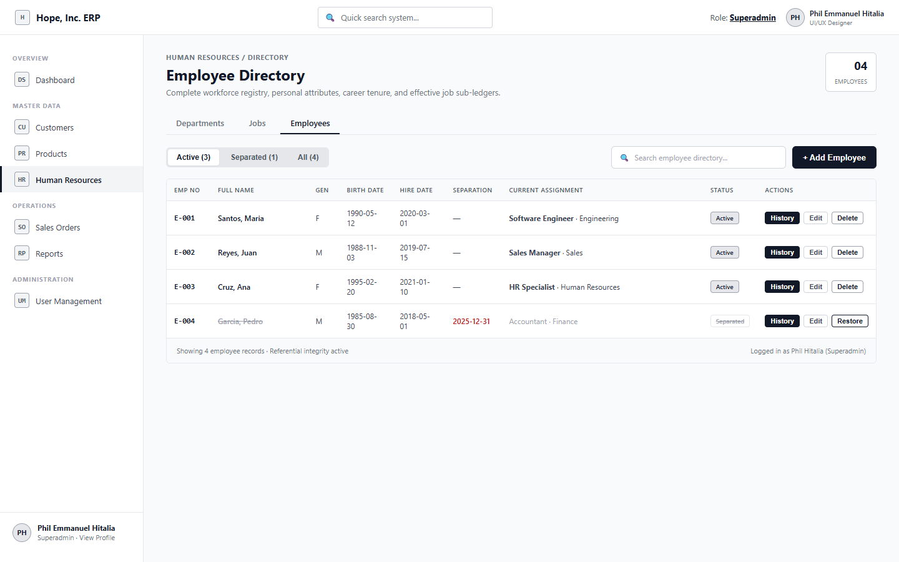
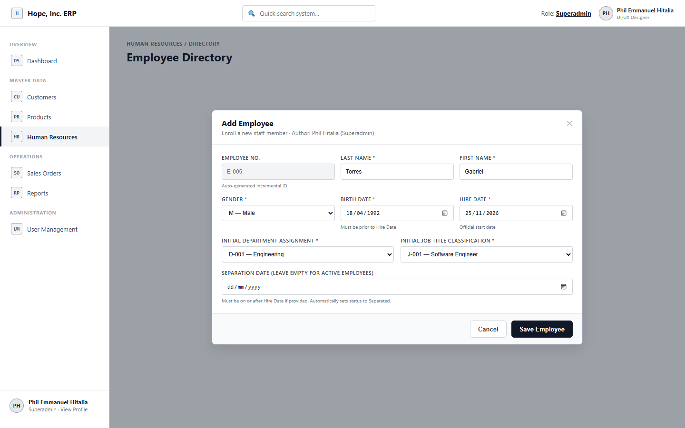
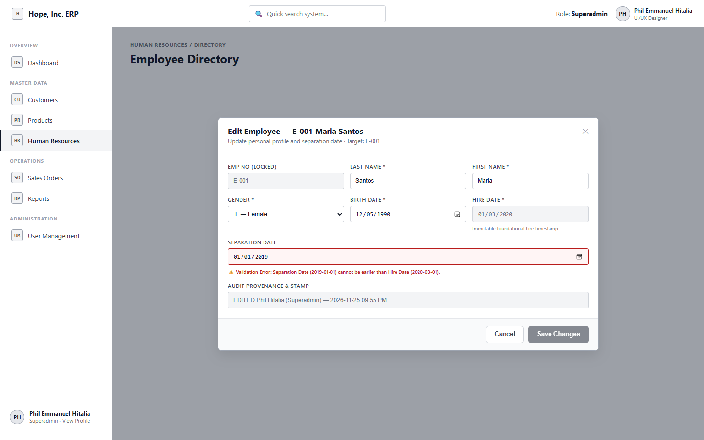
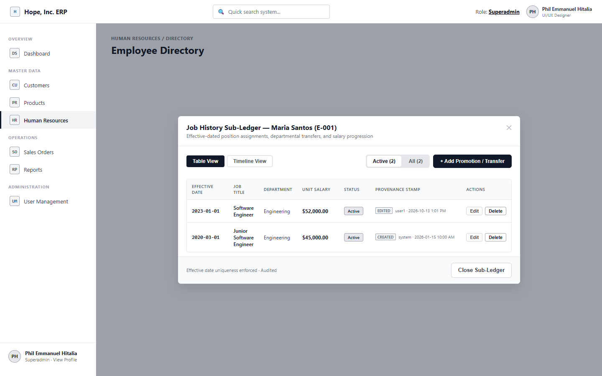
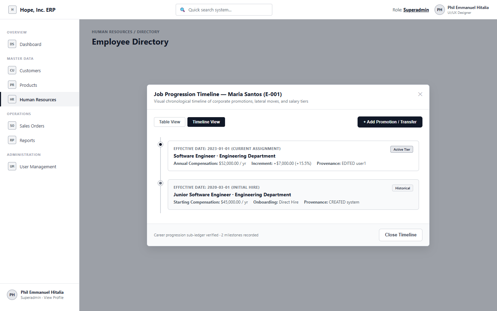
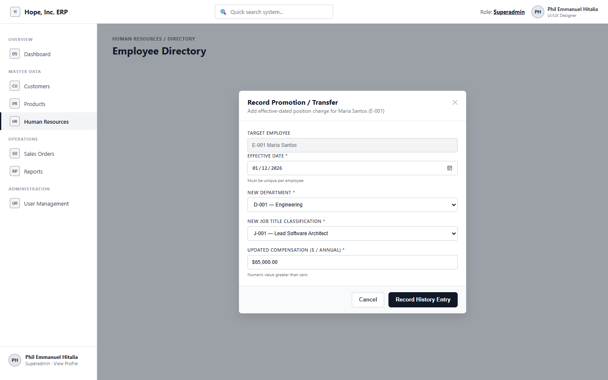
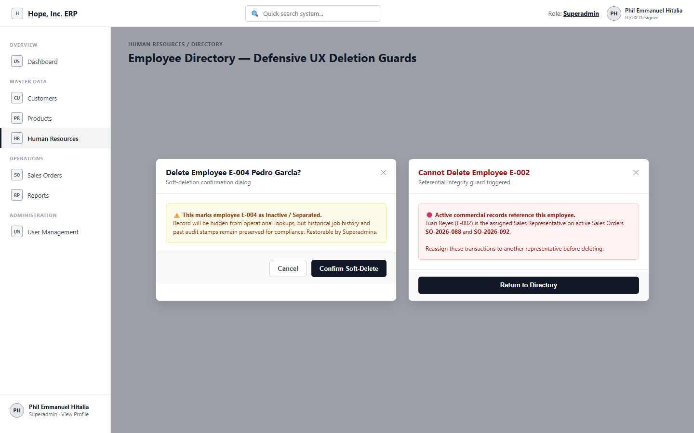
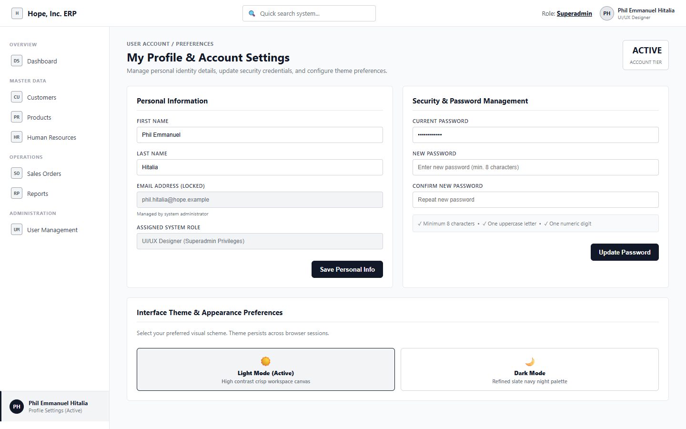
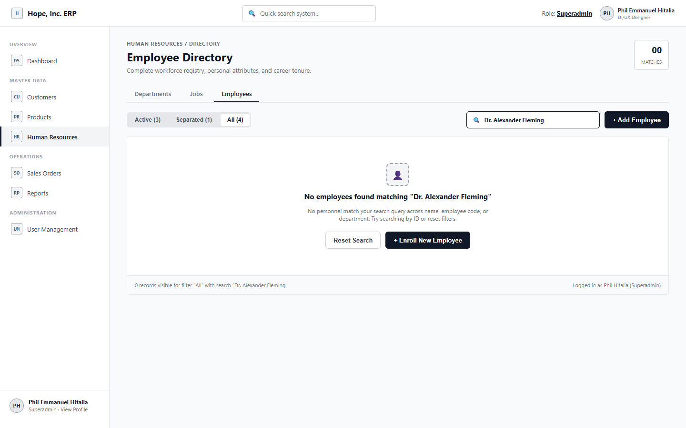

# Hope ERP Employee Directory, Job History & Profile Wireframes

## Task information

| Item | Details |
| ----- | ----- |
| **Task ID** | S3-UIX-02 |
| **Task name** | Wireframes: employee and profile screens |
| **Role** | UI/UX Designer |
| **Assignee** | Phil Emmanuel Hitalia |

## UX Strategy & Architecture

These wireframes define the **Employee Directory**, **Effective-Dated Job History Sub-Ledger**, and **User Profile & Account Settings** interfaces for the Hope ERP system. The architecture separates core personnel identity from temporal job assignments and salary progression while enforcing strict date and security validations:

* **Decoupled Employment & Career Sub-Ledger:** Core personnel attributes (Emp No, Name, Gender, Birth Date, Hire Date, Separation Date) are managed in the Employee Directory, while promotions, departmental transfers, and salary adjustments live in a dedicated **Job History Sub-Ledger** supporting both **Table View** and **Timeline View**.
* **Strict Temporal & Integrity Validations:** Inline form validation blocks invalid employment timelines (e.g., `Separation Date` earlier than `Hire Date`) before submission and prevents duplicate effective dates within an employee's career history.
* **Defensive Workforce Deletion:** Deleting an employee triggers either a soft-delete confirmation (marking them `Inactive / Separated`) or a referential integrity guard if active commercial Sales Orders depend on that employee as a Sales Representative.
* **Self-Service Profile & Security:** Dedicated account settings allow users to update personal details, manage password credentials against explicit strength policies, and toggle workspace themes (`Light Mode` vs. `Dark Mode`).

---

## 1. Employee Directory Main Screen

### Layout and components
* **Header & Context:** Displays the `HUMAN RESOURCES / DIRECTORY` breadcrumb above `"Employee Directory"` (*"Complete workforce registry, personal attributes, career tenure, and effective job sub-ledgers."*), paired with a `04 EMPLOYEES` counter badge.
* **Module Sub-Navigation:** Horizontal tabs (`Departments`, `Jobs`, `Employees` active).
* **Toolbar Controls:**
  * **Status Filter Tabs:** Segmented filter (`Active (3)`, `Separated (1)`, `All (4)`) distinguishing active staff from separated personnel.
  * **Search Bar:** `Search employee directory...` input field.
  * **Primary Action:** Solid dark `+ Add Employee` button.
* **Workforce Data Table:**
  * **Columns:** `EMP NO`, `FULL NAME`, `GEN`, `BIRTH DATE`, `HIRE DATE`, `SEPARATION`, `CURRENT ASSIGNMENT`, `STATUS`, and `ACTIONS`.
  * **Multi-Action Row Controls:** Active employees display a primary `History` button (to open the job history sub-ledger) alongside `Edit` and `Delete`; separated rows (`E-004 Garcia, Pedro` with red separation date `2025-12-31`) swap `Delete` for `Restore`.
* **Administrative Footer:** Confirms active integrity rules (*"Showing 4 employee records · Referential integrity active"*) and active session user.

---

## 2. Add Employee Modal

### Layout and components
* **Modal Header:** Title (`Add Employee`) with author attribution (*"Enroll a new staff member · Author: Phil Hitalia (Superadmin)"*).
* **Three-Column Form Layout:**
  * **Row 1 (Identity):** Auto-generated disabled `Employee No.` (`E-005`), required `Last Name` (`Torres`), and required `First Name` (`Gabriel`).
  * **Row 2 (Demographics & Dates):** `Gender` dropdown (`M — Male`, `F — Female`, `Prefer not to say`), `Birth Date` picker (`1992-04-18` with hint *"Must be prior to Hire Date"*), and `Hire Date` picker (`2026-11-25`).
  * **Row 3 (Initial Placement):** Two-column dropdowns for `Initial Department Assignment` (`D-001 — Engineering`) and `Initial Job Title Classification` (`J-001 — Software Engineer`).
  * **Row 4 (Optional Separation):** `Separation Date` field with helper text noting that providing a date on or after Hire Date automatically sets status to `Separated`.
* **Modal Actions:** `Cancel` and `Save Employee` buttons.

---

## 3. Edit Employee Modal (With Separation Date Validation)

### Layout and components
* **Modal Header:** Contextual title (`Edit Employee — E-001 Maria Santos`) and subtitle (*"Update personal profile and separation date · Target: E-001"*).
* **Form Structure & Inline Validation:**
  * **Locked Identifiers:** `Emp No` (`E-001`) and `Hire Date` (`2020-03-01`) are disabled to preserve foundational onboarding records.
  * **Editable Attributes:** `Last Name`, `First Name`, `Gender`, and `Birth Date`.
  * **Separation Date Error State:** Demonstrates real-time validation when an invalid date (`2019-01-01`) is entered, highlighting the field in red and surfacing an explicit inline error: *"⚠️ Validation Error: Separation Date (2019-01-01) cannot be earlier than Hire Date (2020-03-01)."*
  * **Audit Stamp Preview:** Read-only `EDITED Phil Hitalia (Superadmin) — 2026-11-25 09:55 PM`.
* **Modal Actions:** `Cancel` paired with a disabled `Save Changes` button while validation errors exist.

---

## 4. Job History Sub-Ledger Modal (Table View)

### Layout and components
* **Modal Header:** Identifies the employee scope (`Job History Sub-Ledger — Maria Santos (E-001)`) and subtitle (*"Effective-dated position assignments, departmental transfers, and salary progression"*).
* **Sub-Ledger Toolbar:**
  * **View Switcher:** Toggle buttons for `Table View` (active) and `Timeline View`.
  * **Status Filters & Action:** `Active (2)` / `All (2)` tabs paired with `+ Add Promotion / Transfer`.
* **Sub-Ledger Data Table:**
  * **Columns:** `EFFECTIVE DATE`, `JOB TITLE`, `DEPARTMENT`, `UNIT SALARY`, `STATUS`, `PROVENANCE STAMP`, and `ACTIONS`.
  * **Chronological Records:** Lists `2023-01-01` (`Software Engineer`, `Engineering`, `$52,000.00`, `EDITED user1`) above initial hire `2020-03-01` (`Junior Software Engineer`, `Engineering`, `$45,000.00`, `CREATED system`).
* **Modal Footer:** Confirms `"Effective date uniqueness enforced · Audited"` alongside `Close Sub-Ledger`.

---

## 5. Job History Sub-Ledger Modal (Timeline View)

### Layout and components
* **Modal Header:** `Job Progression Timeline — Maria Santos (E-001)` (*"Visual chronological timeline of corporate promotions, lateral moves, and salary tiers"*).
* **View Switcher:** Highlights `Timeline View` as active alongside `+ Add Promotion / Transfer`.
* **Vertical Progression Timeline:**
  * **Current Assignment Node:** Dark indicator dot connected to a white milestone card showing `Effective Date: 2023-01-01 (Current Assignment)`, `Software Engineer · Engineering Department`, `Active Tier` badge, `Annual Compensation: $52,000.00 / yr`, `Increment: +$7,000.00 (+15.5%)`, and `Provenance: EDITED user1`.
  * **Historical Node:** Muted indicator dot connected to a subtle gray card for `Effective Date: 2020-03-01 (Initial Hire)` (`Junior Software Engineer`, `$45,000.00 / yr`, `Direct Hire`, `CREATED system`).
* **Modal Footer:** Displays `"Career progression sub-ledger verified · 2 milestones recorded"` and `Close Timeline`.

---

## 6. Record Promotion / Transfer Nested Modal

### Layout and components
* **Modal Header:** `Record Promotion / Transfer` (*"Add effective-dated position change for Maria Santos (E-001)"*).
* **Form Structure:**
  * **Top Row:** Locked `Target Employee` (`E-001 Maria Santos`) paired with `Effective Date` picker (`2026-12-01`) with uniqueness hint (*"Must be unique per employee"*).
  * **Department & Role Selectors:** Full-width dropdowns for `New Department` (`D-001 — Engineering`) and `New Job Title Classification` (`J-001 — Lead Software Architect`).
  * **Compensation Input:** `Updated Compensation ($ / Annual)` field (`$65,000.00`) enforcing positive numeric values.
* **Modal Actions:** `Cancel` and `Record History Entry` buttons.

---

## 7. Employee Soft Delete & Referential Integrity Guard Flows

### Layout and components
* **Side-by-Side Defensive UX Comparison:**
  * **Left — Soft Delete Confirmation (`Delete Employee E-004 Pedro Garcia?`):** Amber warning banner (`⚠️`) explaining that the employee will be marked `Inactive / Separated` and hidden from operational lookups while preserving historical job history and audit stamps for compliance. Actions: `Cancel` and `Confirm Soft-Delete`.
  * **Right — Blocked Delete Modal (`Cannot Delete Employee E-002`):** Red referential integrity banner (`🛑`) informing the user that `Juan Reyes (E-002)` is the assigned Sales Representative on active Sales Orders `SO-2026-088` and `SO-2026-092`, requiring reassignment before deletion. Single action: `Return to Directory`.

---

## 8. User Profile & Account Settings Screen

### Layout and components
* **Sidebar Navigation State:** Highlights the bottom-left user profile card (`Phil Emmanuel Hitalia · Profile Settings (Active)`) to reflect navigating via the sidebar footer profile selector rather than the Human Resources module tab.
* **Header & Context:** `USER ACCOUNT / PREFERENCES` breadcrumb above `"My Profile & Account Settings"` (*"Manage personal identity details, update security credentials, and configure theme preferences."*), with an `ACTIVE ACCOUNT TIER` badge.
* **Two-Column Settings Grid:**
  * **Personal Information Card:** Editable `First Name` (`Phil Emmanuel`) and `Last Name` (`Hitalia`), locked `Email Address` (`phil.hitalia@hope.example`), read-only `Assigned System Role` (`UI/UX Designer (Superadmin Privileges)`), and `Save Personal Info` CTA.
  * **Security & Password Management Card:** `Current Password`, `New Password`, and `Confirm New Password` inputs paired with an inline policy checklist (*"✓ Minimum 8 characters • ✓ One uppercase letter • ✓ One numeric digit"*) and `Update Password` CTA.
* **Interface Theme & Appearance Card:** Full-width preferences panel presenting selectable cards for `☀️ Light Mode (Active)` (*"High contrast crisp workspace canvas"*) and `🌙 Dark Mode` (*"Refined slate navy night palette"*).

---

## 9. Employee Empty State / Zero Search Results Screen

### Layout and components
* **Context Preservation:** Retains the `Employees` tab, `All (4)` filter, and active search query (`Dr. Alexander Fleming`) while updating the header badge to `00 MATCHES`.
* **Zero-State Placeholder Card:** Centered dashed-border user icon (`👤`), bold heading (`No employees found matching "Dr. Alexander Fleming"`), supportive search hint, and two recovery buttons (`Reset Search` and `+ Enroll New Employee`).

---
